# ฐานข้อมูลและโครงสร้างตาราง (Database ER Diagram & Data Dictionary)
## ระบบ Vendor Evaluation (PUR-EVA / PRO-EVA)

เอกสารรวบรวมแผนภาพ Entity-Relationship (ER Diagram), ความสัมพันธ์ระหว่างตาราง (Table Relationships), และพจนานุกรมข้อมูล (Data Dictionary) สำหรับตารางทั้งหมดที่เกี่ยวข้องกับแบบฟอร์ม **PUR-EVA** ทั้งใน Schema `WEBFORM` และการเชื่อมโยงกับ `PURSYS`

---

## 1. แผนภาพความสัมพันธ์เชิงเอนทิตี (Entity-Relationship Diagram)

```mermaid
erDiagram
    FORM ||--|| PUREVA_FORM : "has extension data (1:1)"
    FORM ||--o{ FLOW : "has approval steps (1:N)"
    PUREVA_FORM ||--o{ PUREVA_SCORE : "has scores (1:N)"
    PUREVA_FORM ||--o{ PUREVA_PROFIT_TURNOVER : "has financial records (1:N)"
    PUREVA_FORM ||--o{ PUREVA_VENDOR_RELATION : "has business relations (1:N)"
    PUREVA_FORM ||--o{ PURNVF_ADDRESS : "has addresses (1:N)"
    PUREVA_FORM ||--o{ PUR_FILE : "attaches files (1:N)"
    
    PUREVA_FORM }o--o| VENDORS : "references VND_CODE (N:1)"
    PUREVA_FORM }o--o| TERM_PAYMENT : "references STERMCODE (N:1)"
    PUREVA_FORM }o--o| CURRENCY_MASTER : "references CURR_CODE (N:1)"
    PUREVA_FORM }o--o| VORGMST : "references VORGNO (N:1)"

    FORM {
        NUMBER NFRMNO PK "Form Template ID"
        VARCHAR2 VORGNO PK "Organization Code"
        VARCHAR2 CYEAR PK "Fiscal Year (2 digits)"
        VARCHAR2 CYEAR2 PK "Sub Year (4 digits)"
        NUMBER NRUNNO PK "Running Document No"
        VARCHAR2 VREQNO "Requester Employee No"
        VARCHAR2 VINPUTER "Inputter Employee No"
        VARCHAR2 VREMARK "Form Purpose / Remarks"
        DATE DREQDATE "Request Date"
        VARCHAR2 CST "Status: 0=Draft, 1=In-progress, 2=Approved, 3=Rejected"
    }

    PUREVA_FORM {
        NUMBER NFRMNO PK, FK "Form Template ID"
        VARCHAR2 VORGNO PK, FK "Organization Code"
        VARCHAR2 CYEAR PK, FK "Fiscal Year"
        VARCHAR2 CYEAR2 PK, FK "Sub Year"
        NUMBER NRUNNO PK, FK "Running Document No"
        VARCHAR2 OPERATION "N=New Vendor, A=Annual Evaluation"
        VARCHAR2 VENDCODE FK "Vendor Code -> VENDORS.VND_CODE"
        VARCHAR2 UPSTATUS "Update Master Flag (Y/N)"
        VARCHAR2 VENDGROUP "Group: Direct, 6:Non-Production, 8:Subcon"
        VARCHAR2 VENDPURPOSE "Purpose 2nd digit code"
        VARCHAR2 COMNAME "Company Name"
        VARCHAR2 VENDTYPE "Local / Overseas"
        VARCHAR2 TERMCODE FK "Payment Term -> TERM_PAYMENT.STERMCODE"
        VARCHAR2 CURCODE FK "Currency -> CURRENCY_MASTER.CURR_CODE"
        VARCHAR2 COMPLIANCE "Compliance Items (Comma separated)"
        VARCHAR2 LEGAL_STATUS "Legal Status (นิติบุคคล/บุคคลธรรมดา)"
        VARCHAR2 CORPORATE_ID "Corporate Registration No"
        VARCHAR2 TAX_ID "Tax Identification Number"
        VARCHAR2 CONCERNEDORG FK "Concerned Division -> VORGMST.VORGNO"
        NUMBER AMOUNT "Estimated Annual Purchasing Amount"
        VARCHAR2 PUR_LEVEL "Purchasing Level: A, B, C, D"
        NUMBER CAPITAL "Registered Capital"
        VARCHAR2 CAPITAL_CUR FK "Capital Currency -> CURRENCY_MASTER"
        VARCHAR2 JUDGEMENT "Total Evaluation Judgement (A, B, C, D, E)"
        VARCHAR2 MJUDGEMENT "Manager Step 02 Judgement (A, B, C, D, E)"
        VARCHAR2 NVFNO "Reference New Vendor Finding No"
    }

    PUREVA_SCORE {
        NUMBER NFRMNO PK, FK "Form Template ID"
        VARCHAR2 VORGNO PK, FK "Organization Code"
        VARCHAR2 CYEAR PK, FK "Fiscal Year"
        VARCHAR2 CYEAR2 PK, FK "Sub Year"
        NUMBER NRUNNO PK, FK "Running Document No"
        NUMBER EVAID PK "Evaluation Topic Sequence ID"
        VARCHAR2 TOPIC "Evaluation Topic Name"
        VARCHAR2 TOPIC_DESC "Description of Criteria"
        NUMBER SCORE "Score Awarded"
        VARCHAR2 SLEVEL "Level/Grade Awarded (A, B, C, D, E)"
    }

    PUREVA_PROFIT_TURNOVER {
        NUMBER NFRMNO PK, FK "Form Template ID"
        VARCHAR2 VORGNO PK, FK "Organization Code"
        VARCHAR2 CYEAR PK, FK "Fiscal Year"
        VARCHAR2 CYEAR2 PK, FK "Sub Year"
        NUMBER NRUNNO PK, FK "Running Document No"
        NUMBER ID PK "Sequence ID"
        VARCHAR2 RECORD_TYPE "P=Net Profit/Loss, T=Turnover"
        NUMBER MYEAR "Fiscal Year of Record"
        NUMBER AMOUNT "Amount (Currency/Baht)"
    }

    PUREVA_VENDOR_RELATION {
        NUMBER NFRMNO PK, FK "Form Template ID"
        VARCHAR2 VORGNO PK, FK "Organization Code"
        VARCHAR2 CYEAR PK, FK "Fiscal Year"
        VARCHAR2 CYEAR2 PK, FK "Sub Year"
        NUMBER NRUNNO PK, FK "Running Document No"
        NUMBER ID PK "Sequence ID"
        VARCHAR2 ENTITY_TYPE "N=Shareholder, C=Customer, S=Supplier, P=Product"
        VARCHAR2 ENTITY_NAME "Entity or Product Name"
        NUMBER PERCENT "Percentage Ratio (0-100%)"
    }

    PURNVF_ADDRESS {
        NUMBER NFRMNO PK, FK "Form Template ID"
        VARCHAR2 VORGNO PK, FK "Organization Code"
        VARCHAR2 CYEAR PK, FK "Fiscal Year"
        VARCHAR2 CYEAR2 PK, FK "Sub Year"
        NUMBER NRUNNO PK, FK "Running Document No"
        NUMBER ADDRID PK "Address ID (1, 2)"
        VARCHAR2 ADDRTYPE "E=English, T=Thai"
        VARCHAR2 ADDR1 "Address Line 1"
        VARCHAR2 ADDR2 "Address Line 2"
        VARCHAR2 CITY "City"
        VARCHAR2 STATE "State / Province"
        VARCHAR2 COUNTRY "Country"
        VARCHAR2 POSTCODE "Postal Code"
    }

    PUR_FILE {
        NUMBER NFRMNO PK, FK "Form Template ID"
        VARCHAR2 VORGNO PK, FK "Organization Code"
        VARCHAR2 CYEAR PK, FK "Fiscal Year"
        VARCHAR2 CYEAR2 PK, FK "Sub Year"
        NUMBER NRUNNO PK, FK "Running Document No"
        NUMBER FILE_ID PK "File Sequence ID"
        VARCHAR2 FILE_ONAME "Original File Name"
        VARCHAR2 FILE_FNAME "Physical Stored File Name"
        VARCHAR2 FILE_PATH "Storage Directory Path"
        NUMBER FILE_TYPE "11=Cert/VAT, 12=IE, 13=QA, 2=Other"
        VARCHAR2 FILE_USERCREATE "Uploaded by User ID"
        DATE FILE_DATECREATE "Upload Timestamp"
    }
```

---

## 2. พจานุกรมข้อมูลรายละเอียดตาราง (Data Dictionary)

### 2.1 ตารางหลัก: `WEBFORM.PUREVA_FORM`
- **คำอธิบาย:** จัดเก็บข้อมูลคำขอประเมินผู้ขาย (ทั้งผู้ขายใหม่และประจำปี)
- **Primary Key:** `(NFRMNO, VORGNO, CYEAR, CYEAR2, NRUNNO)`

| ชื่อฟิลด์ | ชนิดข้อมูล | ขนาด | อนุญาต NULL | ค่าเริ่มต้น | คำอธิบาย |
| :--- | :--- | :---: | :---: | :---: | :--- |
| `NFRMNO` | NUMBER | 4,0 | NO | - | รหัสประเภทฟอร์ม (Form Template ID) |
| `VORGNO` | VARCHAR2 | 6 | NO | '00' | รหัสหน่วยงานที่สร้างคำขอ |
| `CYEAR` | VARCHAR2 | 2 | NO | - | ปีงบประมาณ 2 หลัก (เช่น '26') |
| `CYEAR2` | VARCHAR2 | 4 | NO | - | ปีงบประมาณ 4 หลัก (เช่น '2026') |
| `NRUNNO` | NUMBER | 7,0 | NO | - | เลขรันนิ่งเอกสาร (Document Running Number) |
| `OPERATION` | VARCHAR2 | 1 | NO | - | ประเภทการประเมิน: `N`=New Vendor, `A`=Annual Evaluation |
| `VENDCODE` | VARCHAR2 | 10 | YES | - | รหัสผู้ขาย (เชื่อมกับ `PURSYS.VENDORS`) |
| `UPSTATUS` | VARCHAR2 | 1 | YES | 'N' | แฟล็กขออัปเดตข้อมูล Master: `Y`/`N` |
| `VENDGROUP` | VARCHAR2 | 50 | NO | - | กลุ่มประเภทผู้ขาย (Direct, 6:Non-Production, 8:Sub-Contractor) |
| `VENDPURPOSE`| VARCHAR2 | 50 | YES | - | วัตถุประสงค์รหัสหลักที่สอง |
| `COMNAME` | VARCHAR2 | 200 | NO | - | ชื่อผู้ขาย / บริษัท |
| `VENDTYPE` | VARCHAR2 | 20 | YES | - | ประเภทผู้ขาย: `Local` (ในประเทศ), `Overseas` (ต่างประเทศ) |
| `CONTACT` | VARCHAR2 | 100 | YES | - | ชื่อผู้ประสานงาน / ผู้ติดต่อ |
| `EMAIL` | VARCHAR2 | 100 | YES | - | อีเมลสำหรับติดต่อ |
| `WEBSITE` | VARCHAR2 | 200 | YES | - | เว็บไซต์บริษัท |
| `TELNO` | VARCHAR2 | 50 | YES | - | หมายเลขโทรศัพท์ |
| `FAX` | VARCHAR2 | 50 | YES | - | หมายเลขโทรสาร |
| `BANKNAME` | VARCHAR2 | 100 | YES | - | ชื่อธนาคาร |
| `BRANCH` | VARCHAR2 | 100 | YES | - | ชื่อสาขาธนาคาร |
| `BANKADDR` | VARCHAR2 | 500 | YES | - | ที่ตั้งสาขาธนาคาร |
| `ACCNUMBER` | VARCHAR2 | 50 | YES | - | เลขที่บัญชีธนาคาร |
| `TERMCODE` | VARCHAR2 | 10 | YES | - | รหัสเงื่อนไขการชำระเงิน (FK: `PURSYS.TERM_PAYMENT`) |
| `CURCODE` | VARCHAR2 | 10 | YES | - | รหัสสกุลเงินหลัก (FK: `PURSYS.CURRENCY_MASTER`) |
| `COMPLIANCE` | VARCHAR2 | 500 | YES | - | รายการ Compliance ที่ปฏิบัติตาม (คั่นด้วยจุลภาค) |
| `COMPLIANCE_OTHER`| VARCHAR2| 500| YES | - | ข้อกำหนด Compliance อื่นๆ |
| `BUSTYPE_REG`| VARCHAR2 | 200 | YES | - | ประเภทธุรกิจตามจดทะเบียน (Non-Production) |
| `BUSTYPE_SUB`| VARCHAR2 | 200 | YES | - | ประเภทธุรกิจที่ยื่นขอ (Non-Production) |
| `PRODCAT` | VARCHAR2 | 200 | YES | - | หมวดหมู่สินค้าตามเครื่องหมายการค้า (Non-Production) |
| `PRODCAT_OTHER`| VARCHAR2| 500 | YES | - | หมวดหมู่สินค้าอื่นๆ ระบุ |
| `LEGAL_STATUS`| VARCHAR2 | 50 | YES | - | สถานะทางกฎหมาย: นิติบุคคล / บุคคลธรรมดา |
| `CORPORATE_ID`| VARCHAR2| 50 | YES | - | เลขทะเบียนนิติบุคคล 13 หลัก |
| `TAX_ID` | VARCHAR2 | 50 | YES | - | เลขประจำตัวผู้เสียภาษีอากร |
| `CONCERNEDORG`| VARCHAR2 | 50 | YES | - | รหัสฝ่ายที่เกี่ยวข้องกับการจัดซื้อ |
| `FY_AMOUNT` | VARCHAR2 | 50 | YES | - | ปีงบประมาณการจัดซื้อที่คาดการณ์ |
| `AMOUNT` | NUMBER | 12,2 | YES | 0 | มูลค่าการจัดซื้อที่คาดการณ์ต่อปี (บาท) |
| `PUR_LEVEL` | VARCHAR2 | 10 | YES | - | ระดับการจัดซื้อ: Level A, B, C, D |
| `PUR_STATUS` | VARCHAR2 | 50 | YES | - | สถานะการใช้งาน (เช่น DO NOT USE) |
| `VENDCAT` | VARCHAR2 | 100 | YES | - | หมวดหมู่ผู้ขาย (สำหรับสายการผลิต Production) |
| `CAPITAL` | NUMBER | 14,2 | YES | 0 | ทุนจดทะเบียน |
| `CAPITAL_CUR`| VARCHAR2 | 10 | YES | - | สกุลเงินของทุนจดทะเบียน |
| `ESTABLISHED`| VARCHAR2 | 50 | YES | - | วันที่ก่อตั้งบริษัท |
| `COM_TYPE` | VARCHAR2 | 100 | YES | - | ประเภทการดำเนินกิจการ (ผลิต, ประกอบ, บริการ ฯลฯ) |
| `COM_OTHER` | VARCHAR2 | 200 | YES | - | ประเภทกิจการอื่นๆ ระบุ |
| `EMPDIRECT` | NUMBER | 6,0 | YES | 0 | จำนวนพนักงานสายผลิตตรง (คน) |
| `EMPINDIRECT`| NUMBER | 6,0 | YES | 0 | จำนวนพนักงานสนับสนุน/ออฟฟิศ (คน) |
| `AVGAGE` | VARCHAR2 | 20 | YES | - | อายุเฉลี่ยของพนักงาน |
| `QM_STATUS` | VARCHAR2 | 10 | YES | - | มีระบบการจัดการคุณภาพหรือไม่ (Y/N) |
| `QM_REASON` | VARCHAR2 | 200 | YES | - | มาตรฐานคุณภาพที่ได้รับ (เช่น ISO9001, IATF16949) |
| `CSR_STATUS` | VARCHAR2 | 10 | YES | - | มีนโยบาย CSR หรือไม่ (Y/N) |
| `CSR_REASON` | VARCHAR2 | 200 | YES | - | รายละเอียดนโยบาย CSR |
| `ENV_STATUS` | VARCHAR2 | 10 | YES | - | มีระบบการจัดการสิ่งแวดล้อมหรือไม่ (Y/N) |
| `ENV_REASON` | VARCHAR2 | 200 | YES | - | มาตรฐานสิ่งแวดล้อมที่ได้รับ (เช่น ISO14001) |
| `LABOR_STATUS`| VARCHAR2 | 10 | YES | - | มีสหภาพแรงงานหรือไม่ (Y/N) |
| `LABOR_ESTABLISH_DATE`| DATE | - | YES | - | วันที่จัดตั้งสหภาพแรงงาน |
| `LAND` | NUMBER | 10,2 | YES | 0 | พื้นที่ดิน (ตารางเมตร) |
| `FACTORY` | NUMBER | 10,2 | YES | 0 | พื้นที่โรงงาน/สิ่งปลูกสร้าง (ตารางเมตร) |
| `JUDGEMENT` | VARCHAR2 | 10 | YES | - | ผลการประเมินคำนวณจากคะแนนรวม (A, B, C, D, E) |
| `MJUDGEMENT`| VARCHAR2 | 10 | YES | - | ผลการประเมินตัดสินใจโดยผู้จัดการฝ่ายจัดซื้อ (Step 02) |
| `ATTACH_TYPE`| VARCHAR2 | 100 | YES | - | รายการประเภทเอกสารแนบ |
| `ATTACH_OTHER`| VARCHAR2| 500 | YES | - | หมายเหตุเอกสารแนบเพิ่มเติม |
| `NVFNO` | VARCHAR2 | 50 | YES | - | รหัสอ้างอิงเอกสารสำรวจผู้ขายเดิม (PRO-NVF) |

---

### 2.2 ตารางคะแนนการประเมิน: `WEBFORM.PUREVA_SCORE`
- **คำอธิบาย:** จัดเก็บคะแนนแยกตามหัวข้อการประเมิน
- **Primary Key:** `(NFRMNO, VORGNO, CYEAR, CYEAR2, NRUNNO, EVAID)`

| ชื่อฟิลด์ | ชนิดข้อมูล | ขนาด | อนุญาต NULL | คำอธิบาย |
| :--- | :--- | :---: | :---: | :--- |
| `NFRMNO` - `NRUNNO` | - | - | NO | Foreign Key อ้างอิงเอกสารหลักใน `PUREVA_FORM` |
| `EVAID` | NUMBER | 4,0 | NO | ลำดับหัวข้อการประเมิน (1, 2, 3...) |
| `TOPIC` | VARCHAR2 | 100 | NO | รหัสหัวข้อ (PRICE LEVEL, FINANCIAL STATEMENT ฯลฯ) |
| `TOPIC_DESC` | VARCHAR2 | 200 | YES | คำอธิบายหัวข้อหรือเกณฑ์การประเมินย่อย |
| `SCORE` | NUMBER | 2,0 | NO | คะแนนที่ได้รับในหัวข้อนี้ (เช่น 25, 20, 15, 10, 5) |
| `SLEVEL` | VARCHAR2 | 10 | YES | ระดับเกรดคะแนนในหัวข้อ (A, B, C, D, E) |

---

### 2.3 ตารางผลประกอบการย้อนหลัง: `WEBFORM.PUREVA_PROFIT_TURNOVER`
- **คำอธิบาย:** จัดเก็บผลประกอบการย้อนหลัง 3 ปี (ยอดขาย Turnover หรือ กำไรสุทธิ Profit)
- **Primary Key:** `(NFRMNO, VORGNO, CYEAR, CYEAR2, NRUNNO, ID)`

| ชื่อฟิลด์ | ชนิดข้อมูล | ขนาด | อนุญาต NULL | คำอธิบาย |
| :--- | :--- | :---: | :---: | :--- |
| `NFRMNO` - `NRUNNO` | - | - | NO | Foreign Key อ้างอิงเอกสารหลักใน `PUREVA_FORM` |
| `ID` | NUMBER | 4,0 | NO | ลำดับแถว (1, 2, 3) |
| `RECORD_TYPE` | VARCHAR2 | 1 | NO | `P` = Net Profit/Loss (Non-Pro), `T` = Turnover (Pro) |
| `MYEAR` | NUMBER | 4,0 | NO | ปี ค.ศ. / พ.ศ. ของผลประกอบการ |
| `AMOUNT` | NUMBER | 14,2 | NO | จำนวนเงิน |

---

### 2.4 ตารางความสัมพันธ์คู่ค้า: `WEBFORM.PUREVA_VENDOR_RELATION`
- **คำอธิบาย:** ข้อมูลผู้ถือหุ้น, ลูกค้ารายใหญ่, ซัพพลายเออร์, และผลิตภัณฑ์หลัก
- **Primary Key:** `(NFRMNO, VORGNO, CYEAR, CYEAR2, NRUNNO, ID)`

| ชื่อฟิลด์ | ชนิดข้อมูล | ขนาด | อนุญาต NULL | คำอธิบาย |
| :--- | :--- | :---: | :---: | :--- |
| `NFRMNO` - `NRUNNO` | - | - | NO | Foreign Key อ้างอิงเอกสารหลักใน `PUREVA_FORM` |
| `ID` | NUMBER | 4,0 | NO | ลำดับแถวข้อมูล |
| `ENTITY_TYPE` | VARCHAR2 | 1 | NO | `N`=Shareholder, `C`=Customer, `S`=Supplier, `P`=Product |
| `ENTITY_NAME` | VARCHAR2 | 200 | NO | ชื่อบุคคล นิติบุคคล หรือชื่อผลิตภัณฑ์ |
| `PERCENT` | NUMBER | 3,0 | NO | สัดส่วนเปอร์เซ็นต์ (0 - 100%) |

---

### 2.5 ตารางที่อยู่: `WEBFORM.PURNVF_ADDRESS`
- **คำอธิบาย:** ที่อยู่ผู้ขายภาษาอังกฤษและภาษาไทย (ใช้ร่วมกันกับแบบฟอร์ม NVF และ EVA)
- **Primary Key:** `(NFRMNO, VORGNO, CYEAR, CYEAR2, NRUNNO, ADDRID)`

| ชื่อฟิลด์ | ชนิดข้อมูล | ขนาด | อนุญาต NULL | คำอธิบาย |
| :--- | :--- | :---: | :---: | :--- |
| `NFRMNO` - `NRUNNO` | - | - | NO | Composite Key อ้างอิงเอกสารหลัก |
| `ADDRID` | NUMBER | 2,0 | NO | ลำดับที่อยู่ (1 = English, 2 = Thai) |
| `ADDRTYPE` | VARCHAR2 | 1 | NO | ประเภทภาษา: `E` = English, `T` = Thai |
| `ADDR1` | VARCHAR2 | 200 | YES | ที่อยู่บรรทัดที่ 1 (หรือที่อยู่ภาษาไทยแบบเต็ม) |
| `ADDR2` | VARCHAR2 | 200 | YES | ที่อยู่บรรทัดที่ 2 |
| `CITY` | VARCHAR2 | 100 | YES | เมือง / อำเภอ |
| `STATE` | VARCHAR2 | 100 | YES | รัฐ / จังหวัด |
| `POSTCODE` | VARCHAR2 | 20 | YES | รหัสไปรษณีย์ |
| `COUNTRY` | VARCHAR2 | 100 | YES | ประเทศ |
