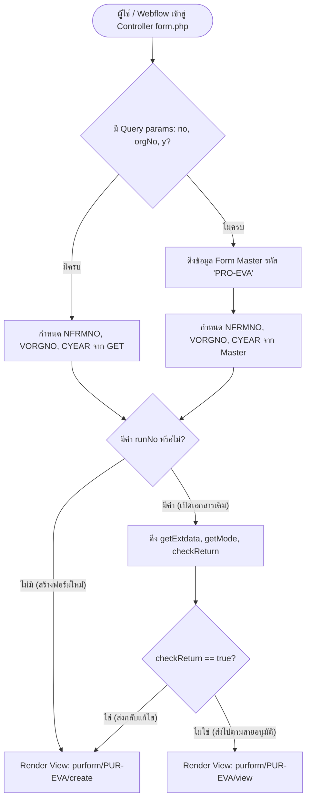
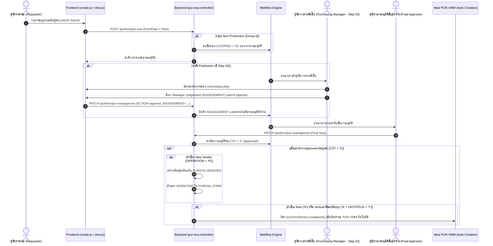

# เอกสารวิเคราะห์และข้อกำหนดระบบ (System Specification)

## ระบบ Vendor Evaluation (PUR-EVA / PRO-EVA)

- **รหัสฟอร์ม:** `PUR-EVA` (หรือ `PRO-EVA` ในระบบ Webflow)
- **โมดูล:** Purchasing Webform System
- **ตำแหน่ง Controller:** `./form/application/controllers/purform/PUR-EVA/form.php`
- **ตำแหน่ง Views:** `./form/application/views/purform/PUR-EVA/`
- **ตำแหน่ง Scripts:** `./form/assets/script/purform/PUR-EVA/`
- **ตำแหน่ง Backend API:** `./api/src/webform/purform/pur-eva/`
- **วันที่จัดทำ:** 2026-11-09

---

## 1. บทนำและวัตถุประสงค์ (Overview & Objectives)

ระบบ **Vendor Evaluation (PUR-EVA / PRO-EVA)** เป็นระบบงานอิเล็กทรอนิกส์ (Webform) สำหรับสายงานจัดซื้อ (Purchasing Department) พัฒนาขึ้นเพื่อใช้ในการประเมินและคัดเลือกผู้ขาย/คู่ค้ารายใหม่ (New Vendor Evaluation) และการประเมินผลการดำเนินงานของผู้ขายประจำปี (Annual Evaluation) ตามมาตรฐานการจัดซื้อและระบบควบคุมคุณภาพขององค์กร

### วัตถุประสงค์หลักของระบบ:
1. **การประเมินผู้ขายรายใหม่ (New Vendor - 'N')**: คัดกรองและประเมินความพร้อมของผู้ขายรายใหม่ก่อนขึ้นทะเบียนเข้าสู่ระบบ โดยสามารถดึงข้อมูลตั้งต้นจากการสำรวจผู้ขายในแบบฟอร์ม **PRO-NVF (New Vendor Finding)** มากรอกโดยอัตโนมัติ
2. **การประเมินผู้ขายประจำปี (Annual Evaluation - 'A')**: ติดตามและประเมินผลการดำเนินงานของผู้ขายเดิมที่มีรหัสในระบบแล้ว พร้อมตัวเลือกในการส่งข้อมูลไปปรับปรุงฐานข้อมูลผู้ขายหลัก (Update Vendor Master - `UPSTATUS = 'Y'`)
3. **การแยกกระบวนการตามประเภทกลุ่มสินค้า/บริการ (Vendor Group Classification)**:
   - **Non-Production (กลุ่ม 6 - Indirect)**: มุ่งเน้นการตรวจสอบสถานะทางกฎหมาย (Legal Status), ภาระภาษี (Tax ID / Corporate ID), รายการสินค้าและบริการตามหมวดหมู่เครื่องหมายการค้า, มาตรการปฏิบัติตามกฎเกณฑ์ (Compliance Checklist สำหรับต่างประเทศ), ประเมินงบประมาณการจัดซื้อประจำปี และเกณฑ์คะแนนตามการให้บริการและราคา
   - **Production (กลุ่ม Direct & Sub-Contractor กลุ่ม 8)**: มุ่งเน้นการประเมินโครงสร้างองค์กร, ผู้ถือหุ้น (Shareholders), ลูกค้ารายใหญ่ (Main Customers), ซัพพลายเออร์หลัก (Suppliers), ผลิตภัณฑ์หลัก (Products), ข้อมูลแรงงาน/โรงงาน, ระบบมาตรฐานคุณภาพ (ISO9001/IATF16949, CSR, ISO14001) และเกณฑ์การประเมินเชิงลึกรอบด้าน 4 หมวดหมู่
4. **การเชื่อมต่อแบบอัตโนมัติ (Automated Downstream Integration)**:
   - เมื่อเอกสารได้รับการอนุมัติสมบูรณ์ (Approved - CST = 2) สำหรับผู้ขายใหม่ ('N') ระบบจะสร้างรหัสคู่ค้าในตาราง `PURSYS.VENDORS` ให้โดยอัตโนมัติ
   - หากเป็นการขึ้นทะเบียนใหม่ ('N') หรือมีการเลือกปรับปรุงข้อมูล ('A' + `UPSTATUS = 'Y'`) ระบบจะส่งข้อมูลไปเปิดแบบฟอร์ม **Vendor Master Maintenance (PUR-VMM)** ให้อัตโนมัติทันที

---

## 2. โครงสร้างไฟล์และสถาปัตยกรรม (Architecture & File Inventory)

ระบบถูกออกแบบแยกส่วนระหว่าง Frontend Presentation (PHP CodeIgniter 3 + Blade Engine), Client Scripting (Vanilla JS / TailwindCSS / DaisyUI), และ Backend Microservices (NestJS + TypeORM เชื่อมต่อฐานข้อมูล Oracle)

```
┌── form (Frontend CodeIgniter 3 + Blade Template)
│   ├── application/controllers/purform/PUR-EVA/
│   │   └── form.php                         <-- Controller หลักที่ถูกเรียกจาก Webflow URL
│   ├── application/views/purform/PUR-EVA/
│   │   ├── create.blade.php                 <-- หน้าจอสำหรับสร้างฟอร์ม / แก้ไขเมื่อถูก Return
│   │   ├── view.blade.php                   <-- หน้าจอสำหรับตรวจสอบและอนุมัติ (Read-only + Decision)
│   │   └── mainrpt.blade.php                <-- หน้าจอค้นหา สืบคืนข้อมูล และส่งออกรายงาน Excel
│   └── assets/script/purform/PUR-EVA/
│       ├── create.js                        <-- Client Logic การสร้างฟอร์ม, การคำนวณคะแนน, Dynamic Rows
│       ├── view.js                          <-- Client Logic การแสดงผล, ตัดสินใจผลประเมิน, การ Approve/Reject
│       ├── report.js                        <-- สคริปต์ค้นหาและสร้าง Excel Export ด้วย ExcelJS
│       ├── formManager.js                   <-- จัดการ Select2, ผูกข้อมูลคะแนน (bindScoreData), ข้อมูลไฟล์
│       ├── function.js                      <-- Helper สำหรับดึง Excel Template จาก File Service
│       └── data.js                          <-- Service Client เรียกใช้ Rest API ของ NestJS
│
└── api (Backend NestJS Core)
    ├── src/webform/purform/pur-eva/
    │   ├── pur-eva.controller.ts            <-- รับ Request สำหรับ Create, Update, Approve
    │   ├── pur-eva-request.service.ts       <-- Service บันทึกการสร้างฟอร์มใหม่, จัดเก็บไฟล์, บันทึกตารางย่อย
    │   ├── pur-eva-update.service.ts        <-- Service ปรับปรุงฟอร์มกรณีถูกส่งกลับมาแก้ไข
    │   ├── pur-eva-approve.service.ts       <-- Service อนุมัติ, จัดการ Step 02, Gen รหัส Vendor และ Auto-trigger VMM
    │   ├── pureva_form/                     <-- Service & Controller สำหรับดึงข้อมูลรายเอกสารและค้นหา
    │   ├── pureva_profit_turnover/          <-- จัดการข้อมูลผลกำไรและยอดขายย้อนหลัง 3 ปี
    │   ├── pureva_score/                    <-- จัดการคะแนนการประเมินแยกตามหมวดหมู่
    │   └── pureva_vendor_relation/          <-- จัดการข้อมูลผู้ถือหุ้น, ลูกค้า, วัตถุดิบ และสินค้า
    └── src/common/Entities/webform/table/
        ├── PUREVA_FORM.entity.ts            <-- Entity ตารางหลัก WEBFORM.PUREVA_FORM
        ├── PUREVA_SCORE.entity.ts           <-- Entity ตารางคะแนน WEBFORM.PUREVA_SCORE
        ├── PUREVA_PROFIT_TURNOVER.entity.ts <-- Entity ตารางผลประกอบการ WEBFORM.PUREVA_PROFIT_TURNOVER
        ├── PUREVA_VENDOR_RELATION.entity.ts <-- Entity ตารางความสัมพันธ์คู่ค้า WEBFORM.PUREVA_VENDOR_RELATION
        ├── PURNVF_ADDRESS.entity.ts         <-- Entity ข้อมูลที่อยู่ผู้ขาย (แชร์ร่วมกับ NVF)
        └── PUR_FILE.entity.ts               <-- Entity ตารางไฟล์แนบในระบบจัดซื้อ
```

---

## 3. การวิเคราะห์ Controller (`form.php`)

### 3.1 Class Hierarchy & Traits
Controller ของ PUR-EVA สืบทอดคุณสมบัติจากคลาสหลักและ Traits ของเฟรมเวิร์ก Webflow ดังนี้:

```php
<?php
use GuzzleHttp\Client;
defined('BASEPATH') OR exit('No direct script access allowed');
require_once APPPATH.'controllers/api/webform/flow.php';
require_once APPPATH.'controllers/api/webform/formmst.php';
require_once APPPATH.'controllers/api/webform/form.php';

class form extends MY_Controller {
    use flow, formmst, formApi;
    protected $client;
    ...
}
```

- **`MY_Controller`**: คลาสฐานสำหรับระบบ Authentication และ Session ของ CodeIgniter
- **`flow` Trait**: จัดการฟังก์ชันกระบวนการอนุมัติ เช่น `checkReturn($form)` เพื่อตรวจว่าเอกสารถูกตีกลับมายังผู้ขอหรือไม่
- **`formmst` Trait**: จัดการดึง Master ข้อมูลแม่แบบฟอร์มผ่าน `getFormMasterByVaname('PRO-EVA')`
- **`formApi` Trait**: เชื่อมต่อข้อมูลส่วนขยาย เช่น `getExtdata($form)` และคำนวณโหมดการทำงาน `getMode($form)`

### 3.2 Routing & Action Flow (`main()`)

เมื่อผู้ใช้เปิดใช้งานผ่าน Webflow Engine ตัว Controller จะประเมิน Query Parameters เพื่อตัดสินใจว่าจะแสดงหน้าจอใด:



### 3.3 รายการ Method ใน Controller

| Method | HTTP Method | รายละเอียดการทำงาน | View ที่ส่งออก |
| :--- | :---: | :--- | :--- |
| `main()` | `GET` | ประเมินสิทธิ์ ตรวจสอบพารามิเตอร์ `runNo`, ดึงข้อมูลโหมด และเรนเดอร์หน้า Create หรือ View | `purform/PUR-EVA/create`<br>`purform/PUR-EVA/view` |
| `mainrpt()` | `GET` | แสดงหน้าจอค้นหา สืบคืนข้อมูล และส่งออกรายงานของระบบ PUR-EVA | `purform/PUR-EVA/mainrpt` |

---

## 4. ข้อกำหนดฟิลด์ข้อมูลและการทำงานของฟอร์ม (Form Specifications)

ฟอร์ม PUR-EVA ถูกออกแบบให้รองรับทั้งข้อมูลทั่วไป (Common Fields) และฟิลด์เฉพาะตามประเภทกลุ่มผู้ขาย (Non-Production vs Production)

### 4.1 ข้อมูลส่วนการร้องขอและประเภทการประเมิน (Operation & Type)

| ชื่อฟิลด์ (HTML / Model) | ประเภท | บังคับ | รายละเอียดและเงื่อนไขทางธุรกิจ |
| :--- | :---: | :---: | :--- |
| `OPERATION` | Radio | ใช่ | ประเภทคำขอ:<br>- `N`: New Vendor (ประเมินผู้ขายใหม่)<br>- `A`: Annual Evaluation (ประเมินประจำปี) |
| `VENDCODE` | Text (5) | กรณี `A` | รหัสผู้ขาย (VND_CODE):<br>- ถ้า `OPERATION = 'A'` จะเปิดให้กรอก และเมื่อพิมพ์ครบ 5 หลัก จะดึงข้อมูลผู้ขายจาก API อัตโนมัติ<br>- ถ้า `OPERATION = 'N'` จะถูกปิดการใช้งาน (Disabled) |
| `UPSTATUS` | Checkbox | ไม่ | ตัวเลือก "Update Vendor Master" (`Y`): อนุญาตให้ติ๊กเฉพาะกรณี `OPERATION = 'A'` เพื่อส่งข้อมูลปรับปรุง Master ต่อไป |
| `NVFNO` | Text | ไม่ | รหัสเอกสาร New Vendor Finding (เช่น `PRO-NVF26-000001`): มีปุ่มเปิด Modal ค้นหาเอกสาร NVF ที่ได้รับการอนุมัติแล้วมาผูกข้อมูลอัตโนมัติ |
| `VENDGROUP` | Radio | ใช่ | กลุ่มผู้ขาย:<br>- `Direct`: วัตถุดิบและชิ้นส่วนการผลิตโดยตรง<br>- `6:Non-Production (6)`: สินค้า/บริการทั่วไปที่ไม่เกี่ยวกับการผลิต (Indirect)<br>- `8:Sub-Contractor (8)`: ผู้รับจ้างช่วงการผลิต |
| `VENDPURPOSE` | Radio | กรณี Pro | วัตถุประสงค์รหัสหลักที่สอง (เช่น Production Parts, Raw Material, Molds/Dies) สำหรับสายงานการผลิต |
| `COMNAME` | Text (200) | ใช่ | ชื่อบริษัทผู้ขาย (Company / Vendor Name) |
| `VENDTYPE` | Radio | ใช่ | แหล่งที่มาของผู้ขาย:<br>- `Local`: ผู้ขายภายในประเทศ (ประเทศไทย)<br>- `Overseas`: ผู้ขายต่างประเทศ |

### 4.2 ข้อมูลที่อยู่และการติดต่อ (Address & Contact Information)

| ชื่อฟิลด์ | ประเภท | จัดเก็บในตาราง | รายละเอียด |
| :--- | :---: | :---: | :--- |
| `ADDRESS1_EN`, `ADDRESS2_EN` | Text | `PURNVF_ADDRESS` (E) | ที่อยู่ภาษาอังกฤษ บรรทัดที่ 1 และ 2 |
| `CITY_EN`, `STATE_EN` | Text | `PURNVF_ADDRESS` (E) | เมือง และจังหวัด/รัฐ |
| `POSTCODE_EN`, `COUNTRY_EN` | Text | `PURNVF_ADDRESS` (E) | รหัสไปรษณีย์ และประเทศ (ถ้าเป็น Local ประเทศจะถูกล็อกเป็น "Thailand") |
| `ADDRESS_TH` | Text | `PURNVF_ADDRESS` (T) | ที่อยู่ภาษาไทยแบบเต็ม (ใช้เฉพาะกรณีผู้ขาย Local) |
| `CONTACT` | Text (90) | `PUREVA_FORM` | ชื่อผู้ประสานงาน / ผู้ติดต่อหลัก |
| `EMAIL` | Text (90) | `PUREVA_FORM` | อีเมลสำหรับติดต่อ |
| `WEBSITE` | Text (200) | `PUREVA_FORM` | เว็บไซต์บริษัท |
| `TELNO`, `FAX` | Text | `PUREVA_FORM` | หมายเลขโทรศัพท์ และโทรสาร |

### 4.3 เงื่อนไขทางการเงินและธนาคาร (Financial & Banking Information)

| ชื่อฟิลด์ | ประเภท | รายละเอียด |
| :--- | :---: | :--- |
| `BANKNAME`, `BRANCH` | Text | ชื่อธนาคาร และสาขา |
| `ACCNUMBER` | Text (13) | เลขที่บัญชีเงินฝากธนาคาร |
| `BANKADDR` | Textarea | ที่อยู่ของสาขาธนาคาร |
| `TERMCODE` | Select2 | รหัสเงื่อนไขการชำระเงิน เชื่อมโยงกับ `PURSYS.TERM_PAYMENT` |
| `CURCODE` | Select2 | สกุลเงินหลักสำหรับการซื้อขาย เชื่อมโยงกับ `PURSYS.CURRENCY_MASTER` |

### 4.4 เอกสารแนบ (Attachment Management)

ระบบแยกประเภทเอกสารแนบตามประเภทไฟล์ เพื่อจัดเก็บในโฟลเดอร์ตาม Path:
`${AMEC_FILE_PATH}${STATE}/Form/PUR/PUREVA/${FORM_NO}/`

| ประเภทไฟล์ | Input Name | File Type ID | การบังคับแนบเอกสาร |
| :--- | :---: | :---: | :--- |
| **Certificate / VAT / Profile** | `fileCer[]` | **11** | บังคับสำหรับ **Non-Production** (หนังสือรับรองบริษัท, ภ.พ.20, Company Profile) |
| **IE Audit Report** | `fileIe[]` | **12** | รายงานการประเมินทางวิศวกรรมอุตสาหการ (สำหรับ Production) |
| **QA Audit Report** | `fileQa[]` | **13** | รายงานการประเมินด้านคุณภาพ (สำหรับ Production) |
| **Other Documents** | `fileOther[]` | **2** | เอกสารแนบอื่นๆ พร้อมช่องกรอกหมายเหตุระบุ `ATTACH_OTHER` |

---

### 4.5 ส่วนเฉพาะ Non-Production Form (`#nonpro`)

เมื่อเลือก `VENDGROUP = '6:Non-Production (6)'` ระบบจะสลับมาแสดงคอนเทนเนอร์ `#nonpro` และปิดการใช้งาน `#pro`:

1. **กรณีผู้ขาย Local (ในประเทศ):**
   - `PRODCAT`: หมวดหมู่สินค้า/บริการตามการจดทะเบียนเครื่องหมายการค้า (มีตัวเลือก "อื่นๆ" พร้อมช่อง `PRODCAT_OTHER`)
   - `LEGAL_STATUS`: สถานะทางกฎหมาย เช่น `นิติบุคคล` หรือ `บุคคลธรรมดา`
   - `CORPORATE_ID`: เลขทะเบียนนิติบุคคล 13 หลัก
   - `TAX_ID`: เลขประจำตัวผู้เสียภาษีอากร
   - `BUSTYPE_REG`: ประเภทธุรกิจตามที่จดทะเบียน
   - `BUSTYPE_SUB`: ประเภทธุรกิจที่ยื่นขอ
2. **กรณีผู้ขาย Overseas (ต่างประเทศ):**
   - `COMPLIANCE`: รายการเช็คบ็อกซ์การปฏิบัติตามกฎเกณฑ์ทางการค้าสากล (Anti-Corruption, Human Rights, Labor Standards ฯลฯ)
   - `COMPLIANCE_OTHER`: รายละเอียดการปฏิบัติตามกฎเกณฑ์อื่นๆ เพิ่มเติม
3. **การประเมินงบประมาณและระดับการจัดซื้อ:**
   - `CONCERNEDORG`: ฝ่าย/แผนกที่เกี่ยวข้องกับการจัดซื้อ
   - `FY_AMOUNT`: ปีงบประมาณที่คาดการณ์
   - `AMOUNT`: มูลค่าการจัดซื้อที่คาดการณ์ต่อปี (บาท)
   - `PUR_LEVEL`: ระดับการจัดซื้อ คำนวณจาก `AMOUNT` โดยอัตโนมัติ:
     - **Level A**: $\ge 1,000,000$ บาท
     - **Level B**: $100,000 - 999,999$ บาท
     - **Level C**: $10,000 - 99,999$ บาท
     - **Level D**: $< 10,000$ บาท
   - `PUR_STATUS`: สถานะ "DO NOT USE" (ติ๊กเมื่อไม่แนะนำให้ใช้งาน)
4. **ผลประกอบการย้อนหลัง 3 ปี:**
   - จัดเก็บในตาราง `PUREVA_PROFIT_TURNOVER` โดยมี `RECORD_TYPE = 'P'` (Net Profit/Loss)
5. **เกณฑ์การให้คะแนน Non-Production Matrix (`#section-eva-non`):**
   - หมวดที่ 1: `FINANCIAL STATEMENT` (งบการเงิน)
   - หมวดที่ 2: `QUALITY CLASSIFICATION` (การรับรองคุณภาพ)
   - หมวดที่ 3: `ENVIRONMENTAL` (การจัดการสิ่งแวดล้อม)
   - หมวดที่ 4: `ADVANCE VERIFYING` (การตรวจสอบราคาและเอกสารล่วงหน้า)

---

### 4.6 ส่วนเฉพาะ Production Form (`#pro`)

เมื่อเลือก `VENDGROUP != '6:Non-Production'` ระบบจะสลับมาแสดงคอนเทนเนอร์ `#pro`:

1. **ข้อมูลทั่วไป:**
   - `VENDCAT`: หมวดหมู่สินค้า/ชิ้นส่วนผู้ขาย
   - `TAX_ID`: เลขประจำตัวผู้เสียภาษี
   - `CAPITAL` & `CAPITAL_CUR`: ทุนจดทะเบียนและสกุลเงินของทุน
   - `ESTABLISHED`: วันที่ก่อตั้งบริษัท
   - `COM_TYPE`: ประเภทกิจการ (เช่น ผลิต, ประกอบ, นำเข้า-ส่งออก หรือระบุ `COM_OTHER`)
2. **ตารางโครงสร้างและความสัมพันธ์ทางธุรกิจ (`PUREVA_VENDOR_RELATION`):**
   - **Shareholders (`ENTITY_TYPE = 'N'`):** รายชื่อผู้ถือหุ้นและสัดส่วนร้อยละ (`SHARENAME[]`, `SHAREPER[]`)
   - **Main Customers (`ENTITY_TYPE = 'C'`):** ลูกค้ารายใหญ่และสัดส่วนยอดขาย (`CUSNAME[]`, `CUSPER[]`)
   - **Main Suppliers (`ENTITY_TYPE = 'S'`):** ซัพพลายเออร์วัตถุดิบหลักและสัดส่วน (`SUPNAME[]`, `SUPPER[]`)
   - **Main Products (`ENTITY_TYPE = 'P'`):** ผลิตภัณฑ์หลักและสัดส่วนกำลังการผลิต (`PRONAME[]`, `PROPER[]`)
   *(มีปุ่ม Dynamic Add/Remove Row ในแต่ละตาราง)*
3. **บุคลากรและสถานที่:**
   - `EMPDIRECT`: พนักงานสายการผลิตตรง (คน)
   - `EMPINDIRECT`: พนักงานสนับสนุน/ออฟฟิศ (คน)
   - ผลรวมพนักงานทั้งหมด (Total Employees คำนวณให้อัตโนมัติ)
   - `AVGAGE`: อายุเฉลี่ยของพนักงาน
   - `LAND`: พื้นที่ดินทั้งหมด (ตร.ม.)
   - `FACTORY`: พื้นที่โรงงาน/สิ่งปลูกสร้าง (ตร.ม.)
4. **มาตรฐานการจัดการและแรงงานสัมพันธ์:**
   - `QM_STATUS` & `QM_REASON`: ระบบการจัดการคุณภาพ (Quality Management System)
   - `CSR_STATUS` & `CSR_REASON`: นโยบายความรับผิดชอบต่อสังคม (CSR)
   - `ENV_STATUS` & `ENV_REASON`: ระบบการจัดการสิ่งแวดล้อม (Environmental Management)
   - `LABOR_STATUS` & `LABOR_ESTABLISH_DATE`: สหภาพแรงงาน/คณะกรรมการลูกจ้าง และวันที่จัดตั้ง
5. **ยอดขายย้อนหลัง 3 ปี:**
   - จัดเก็บในตาราง `PUREVA_PROFIT_TURNOVER` โดยมี `RECORD_TYPE = 'T'` (Turnover)
6. **เกณฑ์การให้คะแนน Production Matrix (`#section-eva-pro`):**
   - หมวดที่ 1: `PRICE LEVEL` (ระดับราคา) [25, 20, 15, 10, 5 คะแนน]
   - หมวดที่ 2: `ORDER MANAGEMENT` (การจัดการคำสั่งซื้อ) [25, 20, 15, 10, 5 คะแนน]
   - หมวดที่ 3: `CUSTOMER SERVICE` (การบริการลูกค้า) [25, 20, 15, 10, 5 คะแนน]
   - หมวดที่ 4: `STANDARD DELIVERY` (มาตรฐานการส่งมอบ) [25, 20, 15, 10, 5 คะแนน]
   *(คะแนนเต็มรวม 100 คะแนน)*

---

### 4.7 เกณฑ์การตัดสินผลคะแนนรวม (Evaluation Grading Scale)

ทั้งสองแบบฟอร์มจะรวมคะแนนจากทุกหมวดและแปลงเป็นเกรดการประเมิน (`JUDGEMENT`) ดังนี้:

| ช่วงคะแนนรวม | ระดับเกรด | ผลการประเมิน (Evaluation Result) | คลาสสี UI |
| :---: | :---: | :--- | :--- |
| **80 - 100** | **A** | `EXCELLENT (80 UP)` | สีเขียว (`text-green-600`) |
| **70 - 79** | **B** | `GOOD (70 UP)` | สีน้ำเงิน (`text-blue-600`) |
| **60 - 69** | **C** | `FAIR (60 UP)` | สีส้ม (`text-orange-500`) |
| **40 - 59** | **D** | `POOR (40 UP)` | สีเหลืองอำพัน (`text-amber-600`) |
| **< 40** | **E** | `NOT APPLICABLE (LESS THAN 40)` | สีแดง (`text-red-600`) |

---

## 5. การวิเคราะห์ Frontend Client Scripts

### 5.1 `create.js` (Form Logic & Dynamic Interaction)
- **NVF Integration:** ค้นหาเอกสาร `searchNVFForm(keyword)` เมื่อผู้ใช้กดเลือกผลลัพธ์ ระบบจะเรียก `setVendorInfo(rowData)` เพื่อนำที่อยู่, ชื่อบริษัท, เลขประจำตัวผู้เสียภาษี และไฟล์แนบมาใส่ลงในฟอร์มทันที
- **Dynamic Calculation:**
  - ติดตาม Event `input` ที่ `#AMOUNT` เพื่อคำนวณและเลือก Radio `PUR_LEVEL` (A/B/C/D)
  - ติดตาม Event `change` ของ Radio การให้คะแนน เพื่อเรียกฟังก์ชัน `calculateScore()` คำนวณผลรวมและเกรด
- **Table Validation:** มีฟังก์ชัน `validateTablePair()` เพื่อตรวจสอบว่าหากผู้ใช้กรอกชื่อผู้ถือหุ้น/ลูกค้า/ซัพพลายเออร์ จะต้องกรอกสัดส่วนเปอร์เซ็นต์ให้ครบถ้วนทั้งคู่เสมอ
- **Data Packaging (`packPurevaFormData`):**
  - ลบ Comma ออกจากตัวเลขทั้งหมด
  - รวบรวม Arrays: `SCORES`, `PROFIT_TURNOVERS`, `RELATIONS`, `DELETE_FILES`
  - ทำความสะอาดฟิลด์ที่ไม่ได้ใช้งานและแปลงเป็น `FormData` ก่อนส่งไปยัง API

### 5.2 `view.js` (Read-only Rendering & Decision Making)
- **ข้อมูลส่วนขยายและ Flow:** เรียก API `getExtData` และ `showflow` เพื่อตรวจสอบขั้นตอนปัจจุบัน
- **Step 02 Judgement:** หากเป็นผู้อนุมัติใน Step `02` (`cextdata == '02'`) ของผู้ขายกลุ่ม Production ระบบจะแสดงช่อง Radio ให้ผู้จัดการฝ่ายจัดซื้อประเมิน `MJUDGEMENT` (A, B, C, D, E) ก่อนกดอนุมัติ
- **Readonly Data Binding:** แปลงรหัสต่างๆ เป็นข้อความที่อ่านง่าย (เช่น รหัสเงื่อนไขการชำระเงิน, สกุลเงิน, ที่อยู่ภาษาไทย/อังกฤษ, การผูกข้อมูลตารางสัมพันธ์)
- **Action Control:** จัดการปุ่ม Approve, Reject, Return ตามสิทธิ์และสถานะของ Webflow

### 5.3 `report.js` (Query & Excel Generation)
- **Dynamic Organization Filters:** ดึงข้อมูลโครงสร้างฝ่าย/แผนกผ่าน `getOrganize()` และจัดการ Select2 สำหรับ Section, Department, Division
- **ExcelJS Template Processing:**
  - โหลดแม่แบบไฟล์ Excel จาก Service: `temprptIndirect.xlsx` (สำหรับ Non-Production) และ `temprptDirect.xlsx` (สำหรับ Direct/Subcon)
  - เขียนข้อมูลลง Cell ใน Worksheet โดยตรง พร้อมการจัดรูปแบบตัวเลขและวันที่
  - รองรับการ Export เอกสารพร้อมดาวน์โหลดสู่เครื่องผู้ใช้

---

## 6. ข้อกำหนดกระบวนการอนุมัติ (Workflow & Approval Specifications)

### 6.1 ลำดับขั้นตอนการอนุมัติ (Workflow Sequence Diagram)



### 6.2 ข้อยกเว้นและกฎเกณฑ์พิเศษของสายอนุมัติ
1. **การข้ามขั้นตอนที่ 02 สำหรับ Non-Production:**
   ในไฟล์ `pur-eva-request.service.ts`:
   ```typescript
   if (dto.VENDGROUP === '6:Non-Production (6)') {
       await this.deleteFlowStepService.deleteFlowStep({
           ...form,
           CSTEPNO: '02',
       });
   }
   ```
   ผู้ขายกลุ่ม Non-Production ไม่ต้องผ่านขั้นตอนการประเมินทางวิศวกรรม/กระบวนการผลิตของ Step 02 ระบบจึงตัดขั้นตอนนี้ออกโดยอัตโนมัติ
2. **การบังคับระบุเหตุผลเมื่อ Return หรือ Reject:**
   ใน `view.js` หากผู้ใช้กดปุ่มที่ไม่ใช่ `approve` ระบบจะตรวจสอบว่าช่อง `txtRemark` มีการระบุเหตุผลหรือไม่ หากเป็นค่าว่างจะแสดง Warning และไม่อนุญาตให้ส่งคำขอ

---

## 7. สัญญา API ฝั่ง Backend (Backend API Contracts)

### 7.1 สร้างคำขอประเมินผู้ขายใหม่ (`POST /purform/pur-eva`)
- **Content-Type:** `multipart/form-data`
- **Controller Method:** `PurEvaController.create()`
- **Headers:** Bearer Token, Client IP
- **Form Data Parameters:**
  - ข้อมูลส่วนหัว: `NFRMNO`, `VORGNO`, `CYEAR`, `REQBY`, `INPUTBY`, `REMARK`, `DRAFT`
  - ข้อมูลประเมิน: `OPERATION`, `VENDGROUP`, `COMNAME`, `VENDTYPE`, `TERMCODE`, `CURCODE`, `AMOUNT`, `PUR_LEVEL` ฯลฯ
  - Arrays ในรูปแบบ Object:
    - `SCORES[i][TOPIC]`, `SCORES[i][SCORE]`, `SCORES[i][SLEVEL]`
    - `PROFIT_TURNOVERS[i][RECORD_TYPE]`, `PROFIT_TURNOVERS[i][MYEAR]`, `PROFIT_TURNOVERS[i][AMOUNT]`
    - `RELATIONS[i][ENTITY_TYPE]`, `RELATIONS[i][ENTITY_NAME]`, `RELATIONS[i][PERCENT]`
  - Files: `fileCer[]`, `fileIe[]`, `fileQa[]`, `fileOther[]`
- **Response Format:**
  ```json
  {
    "status": true,
    "message": "Request successful"
  }
  ```

### 7.2 แก้ไขคำขอเดิมเมื่อถูกส่งกลับ (`PATCH /purform/pur-eva`)
- **Content-Type:** `multipart/form-data`
- **Controller Method:** `PurEvaController.update()`
- **Parameters เพิ่มเติม:**
  - `CYEAR2`, `NRUNNO` (ระบุเอกสาร)
  - `ACTION`: `'save'` หรือ `'approve'`
  - `DELETE_FILES[]`: Array ของ `FILE_ID` ที่ผู้ใช้กดลบออกจากระบบ

### 7.3 ดำเนินการอนุมัติ / ตีกลับ / ปฏิเสธ (`PATCH /purform/pur-eva/approve`)
- **Content-Type:** `application/json`
- **Controller Method:** `PurEvaController.approve()`
- **Request Body:**
  ```json
  {
    "NFRMNO": 10,
    "VORGNO": "00",
    "CYEAR": "26",
    "CYEAR2": "2026",
    "NRUNNO": 1,
    "EMPNO": "0905001",
    "ACTION": "approve",
    "EXTDATA": "02",
    "REMARK": "Approve with condition",
    "MJUDGEMENT": "A"
  }
  ```
- **Response Format:**
  ```json
  {
    "status": true,
    "message": "Approve successful"
  }
  ```

### 7.4 ดึงข้อมูลรายละเอียดเอกสาร (`POST /purform/pureva-form/data`)
- **Content-Type:** `application/json`
- **Controller Method:** `PurevaFormController.create()` (รับ `FormDto`)
- **Request Body:**
  ```json
  {
    "NFRMNO": 10,
    "VORGNO": "00",
    "CYEAR": "26",
    "CYEAR2": "2026",
    "NRUNNO": 1
  }
  ```
- **Response Structure:** คืน Object `PUREVA_FORM` พร้อม Relations ทั้งหมด:
  `PROFIT_TURNOVERS`, `SCORES`, `RELATIONS`, `ADDRESSES`, `FILES`, `TERM`, `STDCUR`, `CAPCUR`, `VORG`, `FORM`

---

## 8. โครงสร้างฐานข้อมูลและการเชื่อมโยง (Database Schema & Entities)

### 8.1 ตารางหลัก: `WEBFORM.PUREVA_FORM`
เก็บข้อมูลหลักของแบบฟอร์มประเมินผู้ขาย เชื่อมต่อแบบ 1:1 กับ `WEBFORM.FORM`

| Column Name | Data Type | Nullable | Description / Key |
| :--- | :--- | :---: | :--- |
| `NFRMNO` | NUMBER | NO | Primary Key (Composite) - รหัสแบบฟอร์ม |
| `VORGNO` | VARCHAR2(6) | NO | Primary Key (Composite) - รหัสหน่วยงาน |
| `CYEAR` | VARCHAR2(2) | NO | Primary Key (Composite) - ปีงบประมาณ 2 หลัก |
| `CYEAR2` | VARCHAR2(4) | NO | Primary Key (Composite) - ปี ค.ศ. 4 หลัก |
| `NRUNNO` | NUMBER | NO | Primary Key (Composite) - เลขที่เอกสารรันนิ่ง |
| `OPERATION` | VARCHAR2(1) | NO | ประเภทคำขอ (N=New, A=Annual) |
| `VENDCODE` | VARCHAR2(10) | YES | รหัสผู้ขาย (เชื่อมโยง PURSYS.VENDORS) |
| `UPSTATUS` | VARCHAR2(1) | YES | ปรับปรุง Master หรือไม่ (Y/N) |
| `VENDGROUP` | VARCHAR2(50) | NO | กลุ่มผู้ขาย (Direct, 6:Non-Production, 8:Subcon) |
| `VENDPURPOSE` | VARCHAR2(50) | YES | วัตถุประสงค์รหัสหลักที่สอง |
| `COMNAME` | VARCHAR2(200) | NO | ชื่อบริษัทผู้ขาย |
| `VENDTYPE` | VARCHAR2(20) | YES | แหล่งที่มา (Local / Overseas) |
| `CONTACT` | VARCHAR2(100) | YES | ชื่อผู้ติดต่อ |
| `EMAIL` | VARCHAR2(100) | YES | อีเมลติดต่อ |
| `WEBSITE` | VARCHAR2(200) | YES | เว็บไซต์บริษัท |
| `TELNO` | VARCHAR2(50) | YES | เบอร์โทรศัพท์ |
| `FAX` | VARCHAR2(50) | YES | เบอร์โทรสาร |
| `BANKNAME` | VARCHAR2(100) | YES | ชื่อธนาคาร |
| `BRANCH` | VARCHAR2(100) | YES | สาขาธนาคาร |
| `BANKADDR` | VARCHAR2(500) | YES | ที่อยู่ธนาคาร |
| `ACCNUMBER` | VARCHAR2(50) | YES | เลขที่บัญชีธนาคาร |
| `TERMCODE` | VARCHAR2(10) | YES | เงื่อนไขการชำระเงิน (FK: TERM_PAYMENT) |
| `CURCODE` | VARCHAR2(10) | YES | สกุลเงินซื้อขาย (FK: CURRENCY_MASTER) |
| `COMPLIANCE` | VARCHAR2(500) | YES | รายการ Compliance ที่ปฏิบัติตาม (Comma separated) |
| `COMPLIANCE_OTHER`| VARCHAR2(500)| YES | รายละเอียด Compliance อื่นๆ |
| `BUSTYPE_REG` | VARCHAR2(200) | YES | ประเภทธุรกิจตามจดทะเบียน |
| `BUSTYPE_SUB` | VARCHAR2(200) | YES | ประเภทธุรกิจที่ยื่นขอ |
| `PRODCAT` | VARCHAR2(200) | YES | หมวดหมู่สินค้าตามเครื่องหมายการค้า |
| `PRODCAT_OTHER` | VARCHAR2(500)| YES | หมวดหมู่สินค้าอื่นๆ ระบุ |
| `LEGAL_STATUS` | VARCHAR2(50) | YES | สถานะทางกฎหมาย (นิติบุคคล / บุคคลธรรมดา) |
| `CORPORATE_ID` | VARCHAR2(50) | YES | เลขทะเบียนนิติบุคคล |
| `TAX_ID` | VARCHAR2(50) | YES | เลขประจำตัวผู้เสียภาษีอากร |
| `CONCERNEDORG` | VARCHAR2(50) | YES | ฝ่ายที่เกี่ยวข้อง (FK: VORGMST) |
| `FY_AMOUNT` | VARCHAR2(50) | YES | ปีงบประมาณการจัดซื้อ |
| `AMOUNT` | NUMBER(12,2) | YES | มูลค่าการจัดซื้อคาดการณ์ (บาท) |
| `PUR_LEVEL` | VARCHAR2(10) | YES | ระดับการจัดซื้อ (A, B, C, D) |
| `PUR_STATUS` | VARCHAR2(50) | YES | สถานะการจัดซื้อ (DO NOT USE) |
| `VENDCAT` | VARCHAR2(100) | YES | หมวดหมู่ผู้ขาย (ฝ่ายผลิต) |
| `CAPITAL` | NUMBER(14,2) | YES | ทุนจดทะเบียน |
| `CAPITAL_CUR` | VARCHAR2(10) | YES | สกุลเงินของทุน (FK: CURRENCY_MASTER) |
| `ESTABLISHED` | VARCHAR2(50) | YES | วันที่ก่อตั้งบริษัท |
| `COM_TYPE` | VARCHAR2(100) | YES | ประเภทบริษัท |
| `COM_OTHER` | VARCHAR2(200) | YES | ประเภทบริษัทอื่นๆ ระบุ |
| `EMPDIRECT` | NUMBER(6,0) | YES | จำนวนพนักงานตรง |
| `EMPINDIRECT` | NUMBER(6,0) | YES | จำนวนพนักงานสนับสนุน |
| `AVGAGE` | VARCHAR2(20) | YES | อายุเฉลี่ยพนักงาน |
| `QM_STATUS` | VARCHAR2(10) | YES | สถานะระบบควบคุมคุณภาพ (Y/N) |
| `QM_REASON` | VARCHAR2(200) | YES | รายละเอียด/มาตรฐานคุณภาพ |
| `CSR_STATUS` | VARCHAR2(10) | YES | สถานะนโยบาย CSR (Y/N) |
| `CSR_REASON` | VARCHAR2(200) | YES | รายละเอียดนโยบาย CSR |
| `ENV_STATUS` | VARCHAR2(10) | YES | สถานะระบบสิ่งแวดล้อม (Y/N) |
| `ENV_REASON` | VARCHAR2(200) | YES | รายละเอียดระบบสิ่งแวดล้อม |
| `LABOR_STATUS` | VARCHAR2(10) | YES | สถานะสหภาพแรงงาน (Y/N) |
| `LABOR_ESTABLISH_DATE` | DATE | YES | วันที่จัดตั้งสหภาพแรงงาน |
| `LAND` | NUMBER(10,2) | YES | พื้นที่ดิน (ตร.ม.) |
| `FACTORY` | NUMBER(10,2) | YES | พื้นที่โรงงาน (ตร.ม.) |
| `JUDGEMENT` | VARCHAR2(10) | YES | ผลการประเมินรวม (A, B, C, D, E) |
| `MJUDGEMENT` | VARCHAR2(10) | YES | ผลการประเมินโดยผู้จัดการ (Step 02) |
| `ATTACH_TYPE` | VARCHAR2(100)| YES | ประเภทเอกสารแนบ |
| `ATTACH_OTHER`| VARCHAR2(500)| YES | หมายเหตุเอกสารแนบอื่นๆ |
| `NVFNO` | VARCHAR2(50) | YES | เลขที่เอกสารอ้างอิง NVF |

---

### 8.2 ตารางคะแนนการประเมิน: `WEBFORM.PUREVA_SCORE`
เก็บคะแนนแยกตามหัวข้อการประเมิน (Composite Key 6 ตัว: Form Key + EVAID)

| Column Name | Data Type | Key | Description |
| :--- | :--- | :---: | :--- |
| `NFRMNO` | NUMBER | PK, FK | รหัสแบบฟอร์ม |
| `VORGNO` | VARCHAR2(6) | PK, FK | รหัสหน่วยงาน |
| `CYEAR` | VARCHAR2(2) | PK, FK | ปีงบประมาณ 2 หลัก |
| `CYEAR2` | VARCHAR2(4) | PK, FK | ปี ค.ศ. 4 หลัก |
| `NRUNNO` | NUMBER | PK, FK | เลขที่เอกสารรันนิ่ง |
| `EVAID` | NUMBER | PK | ลำดับหัวข้อการประเมิน (1, 2, 3...) |
| `TOPIC` | VARCHAR2(100) | - | หัวข้อการประเมิน (เช่น PRICE LEVEL, QUALITY CLASSIFICATION) |
| `TOPIC_DESC` | VARCHAR2(200) | - | คำอธิบายรายละเอียดหัวข้อ |
| `SCORE` | NUMBER(2,0) | - | คะแนนที่ได้รับในหัวข้อนั้นๆ |
| `SLEVEL` | VARCHAR2(10) | - | ระดับคะแนน (A, B, C, D, E) |

---

### 8.3 ตารางผลประกอบการย้อนหลัง 3 ปี: `WEBFORM.PUREVA_PROFIT_TURNOVER`
(Composite Key 6 ตัว: Form Key + ID)

| Column Name | Data Type | Key | Description |
| :--- | :--- | :---: | :--- |
| `NFRMNO`, `VORGNO`, `CYEAR`, `CYEAR2`, `NRUNNO` | - | PK, FK | รหัสเอกสารหลัก 5 ตัว |
| `ID` | NUMBER | PK | ลำดับรายการ (1, 2, 3) |
| `RECORD_TYPE` | VARCHAR2(1) | - | ประเภทบันทึก: `P` = Net Profit/Loss, `T` = Turnover |
| `MYEAR` | NUMBER(4,0) | - | ปี พ.ศ. / ค.ศ. ของผลประกอบการ |
| `AMOUNT` | NUMBER(14,2) | - | จำนวนเงิน (บาท หรือตามสกุลเงิน) |

---

### 8.4 ตารางความสัมพันธ์และสัดส่วนคู่ค้า: `WEBFORM.PUREVA_VENDOR_RELATION`
(Composite Key 6 ตัว: Form Key + ID)

| Column Name | Data Type | Key | Description |
| :--- | :--- | :---: | :--- |
| `NFRMNO`, `VORGNO`, `CYEAR`, `CYEAR2`, `NRUNNO` | - | PK, FK | รหัสเอกสารหลัก 5 ตัว |
| `ID` | NUMBER | PK | ลำดับรายการ |
| `ENTITY_TYPE` | VARCHAR2(1) | - | ประเภทความสัมพันธ์:<br>- `N`: ผู้ถือหุ้น (Shareholders)<br>- `C`: ลูกค้ารายใหญ่ (Main Customers)<br>- `S`: ซัพพลายเออร์วัตถุดิบ (Suppliers)<br>- `P`: ผลิตภัณฑ์หลัก (Products) |
| `ENTITY_NAME` | VARCHAR2(200) | - | ชื่อของนิติบุคคล / บุคคล / ผลิตภัณฑ์ |
| `PERCENT` | NUMBER(3,0) | - | สัดส่วนร้อยละ (0 - 100%) |

---

## 9. สรุปผลการวิเคราะห์และข้อเสนอแนะเชิงระบบ (Conclusion & Recommendations)

1. **สถาปัตยกรรมแบบแยกโมดูลที่ชัดเจน (Modular Architecture):**
   การออกแบบแยกตารางความสัมพันธ์ระหว่างตารางหลัก `PUREVA_FORM` กับตารางคะแนน (`PUREVA_SCORE`), ผลประกอบการ (`PUREVA_PROFIT_TURNOVER`), และโครงสร้างองค์กร (`PUREVA_VENDOR_RELATION`) ช่วยให้ระบบรองรับการขยายตัวและปรับเปลี่ยนเกณฑ์การประเมินในอนาคตได้ง่ายโดยไม่กระทบโครงสร้างข้อมูลเดิม
2. **ระบบอัตโนมัติแบบบูรณาการ (End-to-End Automation):**
   จุดเด่นสำคัญของระบบ PUR-EVA คือการเชื่อมโยงวงจรอายุของคู่ค้า (Vendor Lifecycle):
   - ดึงข้อมูลจาก **PUR-NVF** มาเป็นต้นแบบ
   - ผ่านกระบวนการประเมินตามมาตรฐาน
   - สร้างรหัสคู่ค้าใน **PURSYS.VENDORS** ให้ทันทีที่ Approved
   - ส่งต่อข้อมูลไปยัง **PUR-VMM** เพื่อขึ้นทะเบียน Vendor Master อย่างเป็นทางการ ช่วยลดข้อผิดพลาดจากการคีย์ข้อมูลซ้ำซ้อน (Data Redundancy) ได้อย่างสมบูรณ์
3. **ข้อเสนอแนะในการปรับปรุง (Recommendations):**
   - **Audit Trail for Step 02:** ควรจัดเก็บประวัติและ Timestamp ของการให้คะแนน `MJUDGEMENT` ในกรณีที่มีการ Reject หรือ Return กลับมาพิจารณาใหม่
   - **Data Validation Enhancement:** ควรเพิ่ม Validation รูปแบบของ Tax ID และ Corporate ID 13 หลักของประเทศไทยให้เป็นไปตามมาตรฐานการคำนวณ Check Digit ของกรมสรรพากร เพื่อป้องกันการกรอกเลขผิดพลาด
   - **Performance Indexing:** ตาราง `PUREVA_FORM` ควรมี Index บนคอลัมน์ `VENDCODE`, `COMNAME`, และ `NVFNO` เพื่อรองรับการสืบค้นรายงานในปริมาณข้อมูลขนาดใหญ่
