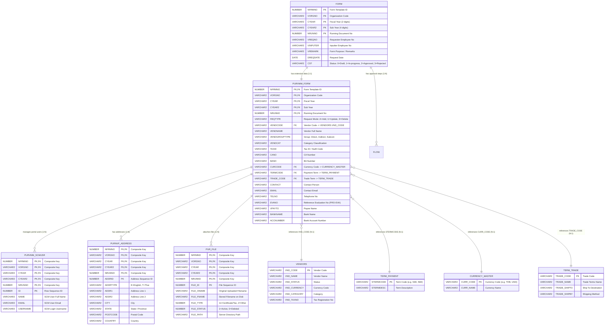

# ฐานข้อมูลและโครงสร้างตาราง (Database ER Diagram & DDL)
## ระบบ Vendor Master Maintenance (PUR-VMM / PRO-VMM)

เอกสารรวบรวมแผนภาพ Entity-Relationship (ER Diagram), ความสัมพันธ์ระหว่างตาราง (Table Relationships), และคำสั่ง Data Definition Language (DDL) สำหรับตารางทั้งหมดที่เกี่ยวข้องกับแบบฟอร์ม **PUR-VMM** ทั้งใน Schema `WEBFORM` และ `PURSYS`

---

## 1. แผนภาพความสัมพันธ์เชิงเอนทิตี (Entity-Relationship Diagram)



---

## 2. คำสั่ง Data Definition Language (DDL)

คำสั่ง DDL ด้านล่างเขียนขึ้นตามมาตรฐาน Oracle SQL (สามารถประยุกต์ใช้กับ PostgreSQL / MySQL ได้โดยปรับชนิดข้อมูลเป็น `VARCHAR`, `INT`, `TIMESTAMP`):

```sql
-- ============================================================================
-- SCHEMA: WEBFORM
-- ============================================================================

-- ----------------------------------------------------------------------------
-- 1. ตาราง Header กลางของ Webflow: WEBFORM.FORM
-- ----------------------------------------------------------------------------
CREATE TABLE WEBFORM.FORM (
    NFRMNO          NUMBER(4,0)       NOT NULL,
    VORGNO          VARCHAR2(6)       DEFAULT '00' NOT NULL,
    CYEAR           VARCHAR2(2)       NOT NULL,
    CYEAR2          VARCHAR2(4)       NOT NULL,
    NRUNNO          NUMBER(7,0)       NOT NULL,
    VREQNO          VARCHAR2(12)      NOT NULL,
    VINPUTER        VARCHAR2(12)      NOT NULL,
    VREMARK         VARCHAR2(1000),
    DREQDATE        DATE              DEFAULT SYSDATE,
    CREQTIME        VARCHAR2(8),
    CST             VARCHAR2(1)       DEFAULT '0' NOT NULL,
    VFORMPAGE       VARCHAR2(1024),
    VREMOTE         VARCHAR2(50),
    CONSTRAINT PK_FORM PRIMARY KEY (NFRMNO, VORGNO, CYEAR, CYEAR2, NRUNNO)
);

COMMENT ON TABLE WEBFORM.FORM IS 'ตาราง Header หลักสำหรับจัดการ Flow เอกสารทั้งหมดในระบบ Webflow';
COMMENT ON COLUMN WEBFORM.FORM.NFRMNO IS 'รหัสฟอร์ม Template ID (เช่น 14 สำหรับ PUR-VMM)';
COMMENT ON COLUMN WEBFORM.FORM.CST IS 'สถานะเอกสาร: 0=Draft, 1=In-progress, 2=Approved, 3=Rejected';


-- ----------------------------------------------------------------------------
-- 2. ตารางข้อมูลหลักของ PUR-VMM: WEBFORM.PURVMM_FORM
-- ----------------------------------------------------------------------------
CREATE TABLE WEBFORM.PURVMM_FORM (
    NFRMNO          NUMBER(4,0)       NOT NULL,
    VORGNO          VARCHAR2(6)       NOT NULL,
    CYEAR           VARCHAR2(2)       NOT NULL,
    CYEAR2          VARCHAR2(4)       NOT NULL,
    NRUNNO          NUMBER(7,0)       NOT NULL,
    REQTYPE         VARCHAR2(1)       NOT NULL,
    VENDCODE        VARCHAR2(10)      NOT NULL,
    VENDNAME        VARCHAR2(200)     NOT NULL,
    VENDGROUPTYPE   VARCHAR2(20)      NOT NULL,
    VENDCAT         VARCHAR2(100),
    TAXID           VARCHAR2(20),
    CANO            VARCHAR2(20),
    BANO            VARCHAR2(20),
    CURCODE         VARCHAR2(5),
    VPAYTO          VARCHAR2(200),
    VTYPE           VARCHAR2(50),
    VPAYTY          VARCHAR2(50),
    TERMCODE        VARCHAR2(10),
    V1TIME          VARCHAR2(50),
    VNALPH          VARCHAR2(50),
    CONTACT         VARCHAR2(100),
    EMAIL           VARCHAR2(100),
    WEBSITE         VARCHAR2(200),
    TELNO           VARCHAR2(50),
    FAX             VARCHAR2(50),
    ACCNUMBER       VARCHAR2(50),
    BANKNAME        VARCHAR2(100),
    BRANCH          VARCHAR2(100),
    BANKADDR        VARCHAR2(255),
    ATTACH_OTHER    VARCHAR2(255),
    EVANO           VARCHAR2(50),
    TRADE_CODE      VARCHAR2(20),
    CONSTRAINT PK_PURVMM_FORM PRIMARY KEY (NFRMNO, VORGNO, CYEAR, CYEAR2, NRUNNO),
    CONSTRAINT FK_PURVMM_TO_FORM FOREIGN KEY (NFRMNO, VORGNO, CYEAR, CYEAR2, NRUNNO)
        REFERENCES WEBFORM.FORM (NFRMNO, VORGNO, CYEAR, CYEAR2, NRUNNO) ON DELETE CASCADE
);

COMMENT ON TABLE WEBFORM.PURVMM_FORM IS 'ตารางบันทึกข้อมูลหลักของฟอร์ม Vendor Master Maintenance';
COMMENT ON COLUMN WEBFORM.PURVMM_FORM.REQTYPE IS 'ประเภทคำขอ: A=Add (เพิ่มใหม่), U=Update (แก้ไข), D=Delete (ยกเลิก)';
COMMENT ON COLUMN WEBFORM.PURVMM_FORM.VENDGROUPTYPE IS 'กลุ่มประเภทผู้ขาย: Direct, Indirect, Subcon';
COMMENT ON COLUMN WEBFORM.PURVMM_FORM.EVANO IS 'เลขที่เอกสารอ้างอิงใบประเมิน PRO-EVA';


-- ----------------------------------------------------------------------------
-- 3. ตารางบัญชีผู้ใช้งานระบบ SCM Portal: WEBFORM.PURVMM_SCMUSR
-- ----------------------------------------------------------------------------
CREATE TABLE WEBFORM.PURVMM_SCMUSR (
    NFRMNO          NUMBER(4,0)       NOT NULL,
    VORGNO          VARCHAR2(6)       NOT NULL,
    CYEAR           VARCHAR2(2)       NOT NULL,
    CYEAR2          VARCHAR2(4)       NOT NULL,
    NRUNNO          NUMBER(7,0)       NOT NULL,
    ID              NUMBER(4,0)       NOT NULL,
    NAME            VARCHAR2(150)     NOT NULL,
    EMAIL           VARCHAR2(100)     NOT NULL,
    USERNAME        VARCHAR2(50)      NOT NULL,
    CONSTRAINT PK_PURVMM_SCMUSR PRIMARY KEY (NFRMNO, VORGNO, CYEAR, CYEAR2, NRUNNO, ID),
    CONSTRAINT FK_PURVMM_SCMUSR FOREIGN KEY (NFRMNO, VORGNO, CYEAR, CYEAR2, NRUNNO)
        REFERENCES WEBFORM.PURVMM_FORM (NFRMNO, VORGNO, CYEAR, CYEAR2, NRUNNO) ON DELETE CASCADE
);

COMMENT ON TABLE WEBFORM.PURVMM_SCMUSR IS 'ตารางรายชื่อบัญชีผู้ใช้งานระบบ E-SCM Portal ที่ผูกกับผู้ขาย';


-- ----------------------------------------------------------------------------
-- 4. ตารางข้อมูลที่อยู่ผู้ขาย (รองรับหลายภาษา): WEBFORM.PURNVF_ADDRESS
-- ----------------------------------------------------------------------------
CREATE TABLE WEBFORM.PURNVF_ADDRESS (
    NFRMNO          NUMBER(4,0)       NOT NULL,
    VORGNO          VARCHAR2(6)       NOT NULL,
    CYEAR           VARCHAR2(2)       NOT NULL,
    CYEAR2          VARCHAR2(4)       NOT NULL,
    NRUNNO          NUMBER(7,0)       NOT NULL,
    ADDRID          NUMBER(3,0)       NOT NULL,
    ADDRTYPE        VARCHAR2(2)       NOT NULL, -- 'E'=English, 'T'=Thai
    ADDR1           VARCHAR2(200),
    ADDR2           VARCHAR2(200),
    CITY            VARCHAR2(100),
    STATE           VARCHAR2(100),
    COUNTRY         VARCHAR2(100),
    POSTCODE        VARCHAR2(20),
    CONSTRAINT PK_PURNVF_ADDRESS PRIMARY KEY (NFRMNO, VORGNO, CYEAR, CYEAR2, NRUNNO, ADDRID),
    CONSTRAINT FK_PURVMM_ADDRESS FOREIGN KEY (NFRMNO, VORGNO, CYEAR, CYEAR2, NRUNNO)
        REFERENCES WEBFORM.PURVMM_FORM (NFRMNO, VORGNO, CYEAR, CYEAR2, NRUNNO) ON DELETE CASCADE
);

COMMENT ON TABLE WEBFORM.PURNVF_ADDRESS IS 'ตารางที่อยู่ผู้ขายทั้งภาษาไทยและภาษาอังกฤษ (ใช้ร่วมกันในสายงาน Purchasing Webform)';


-- ----------------------------------------------------------------------------
-- 5. ตารางจัดการไฟล์แนบ: WEBFORM.PUR_FILE
-- ----------------------------------------------------------------------------
CREATE TABLE WEBFORM.PUR_FILE (
    NFRMNO          NUMBER(4,0)       NOT NULL,
    VORGNO          VARCHAR2(6)       NOT NULL,
    CYEAR           VARCHAR2(2)       NOT NULL,
    CYEAR2          VARCHAR2(4)       NOT NULL,
    NRUNNO          NUMBER(7,0)       NOT NULL,
    FILE_ID         NUMBER(5,0)       NOT NULL,
    FILE_ONAME      VARCHAR2(255)     NOT NULL,
    FILE_FNAME      VARCHAR2(255)     NOT NULL,
    FILE_USERCREATE VARCHAR2(12)      NOT NULL,
    FILE_DATECREATE DATE              DEFAULT SYSDATE,
    FILE_USERUPDATE VARCHAR2(12),
    FILE_DATEUPDATE DATE,
    FILE_TYPE       NUMBER(3,0)       NOT NULL, -- 11=Certificate, 2=Quotation/Other
    FILE_STATUS     NUMBER(1,0)       DEFAULT 1 NOT NULL, -- 1=Active, 0=Deleted
    FILE_PATH       VARCHAR2(500)     NOT NULL,
    CONSTRAINT PK_PUR_FILE PRIMARY KEY (NFRMNO, VORGNO, CYEAR, CYEAR2, NRUNNO, FILE_ID),
    CONSTRAINT FK_PURVMM_FILE FOREIGN KEY (NFRMNO, VORGNO, CYEAR, CYEAR2, NRUNNO)
        REFERENCES WEBFORM.PURVMM_FORM (NFRMNO, VORGNO, CYEAR, CYEAR2, NRUNNO) ON DELETE CASCADE
);

COMMENT ON TABLE WEBFORM.PUR_FILE IS 'ตารางจัดเก็บเอกสารแนบของฟอร์มสายจัดซื้อ (11=Certificate, 2=Other)';


-- ============================================================================
-- SCHEMA: PURSYS (Master & Reference Data)
-- ============================================================================

-- ----------------------------------------------------------------------------
-- 6. ตารางทะเบียนผู้ขาย: PURSYS.VENDORS
-- ----------------------------------------------------------------------------
CREATE TABLE PURSYS.VENDORS (
    VND_CODE        VARCHAR2(10)      NOT NULL,
    VND_NAME        VARCHAR2(200)     NOT NULL,
    VND_REGISTED    DATE,
    VND_STATUS      VARCHAR2(10)      DEFAULT 'ACTIVE',
    VND_TERM        VARCHAR2(10),
    VND_TYPE1       VARCHAR2(50),
    VND_TYPE2       VARCHAR2(50),
    VND_CURRENCY    VARCHAR2(5),
    VND_PAYMENT     VARCHAR2(50),
    VND_ADDRESS1    VARCHAR2(200),
    VND_ADDRESS2    VARCHAR2(200),
    VND_CITY        VARCHAR2(100),
    VND_STATE       VARCHAR2(100),
    VND_COUNTRY     VARCHAR2(100),
    VND_PHONE       VARCHAR2(50),
    VND_FAX         VARCHAR2(50),
    VND_CONTACTNAME VARCHAR2(100),
    VND_CATEGORY    VARCHAR2(100),
    VND_BANO        VARCHAR2(20),
    VND_CANO        VARCHAR2(20),
    VND_TAXNO       VARCHAR2(20),
    CREATE_AT       TIMESTAMP         DEFAULT CURRENT_TIMESTAMP,
    CREATE_BY       VARCHAR2(50),
    UPDATE_AT       TIMESTAMP,
    UPDATE_BY       VARCHAR2(50),
    CONSTRAINT PK_PURSYS_VENDORS PRIMARY KEY (VND_CODE)
);

COMMENT ON TABLE PURSYS.VENDORS IS 'ตาราง Master ทะเบียนผู้ขายของระบบจัดซื้อ (PUR System)';


-- ----------------------------------------------------------------------------
-- 7. ตารางเงื่อนไขการชำระเงิน: PURSYS.TERM_PAYMENT
-- ----------------------------------------------------------------------------
CREATE TABLE PURSYS.TERM_PAYMENT (
    STERMCODE       VARCHAR2(10)      NOT NULL,
    STERMDESC       VARCHAR2(100)     NOT NULL,
    TERMMAP         VARCHAR2(50),
    TERMSEQ         NUMBER(4,0)       DEFAULT 0,
    CONSTRAINT PK_TERM_PAYMENT PRIMARY KEY (STERMCODE)
);


-- ----------------------------------------------------------------------------
-- 8. ตารางสกุลเงิน: PURSYS.CURRENCY_MASTER
-- ----------------------------------------------------------------------------
CREATE TABLE PURSYS.CURRENCY_MASTER (
    CURR_CODE       VARCHAR2(5)       NOT NULL,
    CURR_NAME       VARCHAR2(50)      NOT NULL,
    CURR_STATUS     VARCHAR2(10)      DEFAULT 'ACTIVE',
    CURR_MAP        VARCHAR2(20),
    CONSTRAINT PK_CURRENCY_MASTER PRIMARY KEY (CURR_CODE)
);


-- ----------------------------------------------------------------------------
-- 9. ตารางเงื่อนไขทางการค้า: PURSYS.TERM_TRADE
-- ----------------------------------------------------------------------------
CREATE TABLE PURSYS.TERM_TRADE (
    TRADE_CODE      VARCHAR2(20)      NOT NULL,
    TRADE_NAME      VARCHAR2(100)     NOT NULL,
    TRADE_SHIPTO    VARCHAR2(100),
    TRADE_SHIPBY    VARCHAR2(100),
    TRADE_STATUS    VARCHAR2(10)      DEFAULT 'ACTIVE',
    CONSTRAINT PK_TERM_TRADE PRIMARY KEY (TRADE_CODE)
);
```

---

## 3. ดัชนีและการเพิ่มประสิทธิภาพ (Indexes)

เพื่อรองรับการสืบค้นข้อมูลที่รวดเร็ว แนะนำสร้าง Indexes บน Foreign Key และฟิลด์ที่ใช้ค้นหาบ่อย:

```sql
-- ค้นหาฟอร์มตามรหัสผู้ขาย
CREATE INDEX WEBFORM.IX_PURVMM_VENDCODE ON WEBFORM.PURVMM_FORM (VENDCODE);

-- ค้นหาตามเลขที่เอกสารประเมิน EVA
CREATE INDEX WEBFORM.IX_PURVMM_EVANO ON WEBFORM.PURVMM_FORM (EVANO);

-- ค้นหาตาม Tax ID
CREATE INDEX WEBFORM.IX_PURVMM_TAXID ON WEBFORM.PURVMM_FORM (TAXID);

-- ดัชนีสำหรับไฟล์แนบตามประเภท
CREATE INDEX WEBFORM.IX_PURFILE_TYPE ON WEBFORM.PUR_FILE (FILE_TYPE, FILE_STATUS);
```
