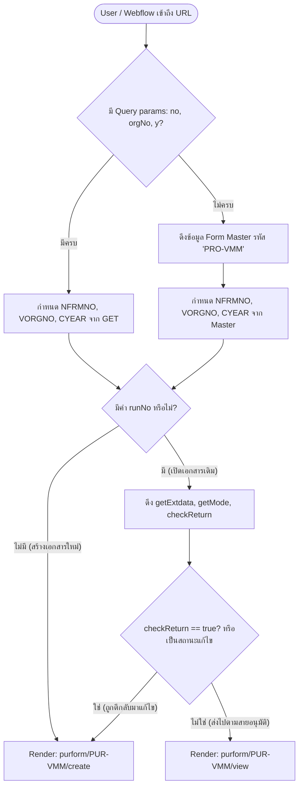
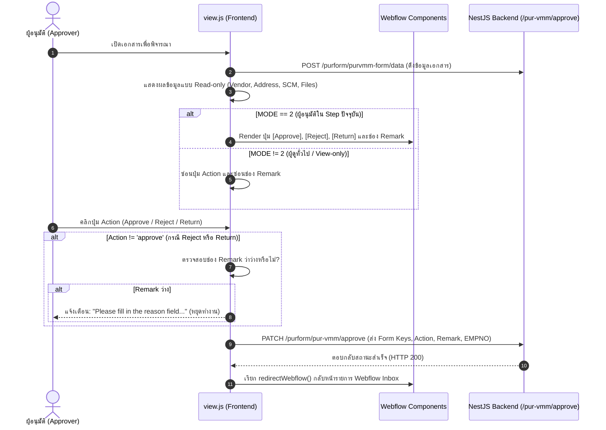

# เอกสารวิเคราะห์และข้อกำหนดระบบ (System Specification)

## ระบบ Vendor Master Maintenance (PUR-VMM / PRO-VMM)

- **รหัสฟอร์ม:** `PUR-VMM` (หรือ `PRO-VMM`)
- **โมดูล:** Purchasing Webform System
- **ตำแหน่ง Controller:** `./form/application/controllers/purform/pur-vmm/form.php`
- **ตำแหน่ง Views:** `./form/application/views/purform/PUR-VMM/`
- **ตำแหน่ง Scripts:** `./form/assets/script/purform/PUR-VMM/`
- **ตำแหน่ง Backend API:** `./api/src/webform/purform/pur-vmm/`
- **วันที่จัดทำ:** 2026-11-09

---

## 1. บทนำและวัตถุประสงค์ (Overview & Objectives)

ระบบ **Vendor Master Maintenance (PUR-VMM)** เป็นระบบงานอิเล็กทรอนิกส์ (Webform) สำหรับสายงานจัดซื้อ (Purchasing) ใช้ในการขออนุมัติ:

1. **เพิ่มข้อมูลผู้ขายรายใหม่ (Add - 'A')**: บันทึกข้อมูลบริษัท, ที่อยู่, เลขประจำตัวผู้เสียภาษี, เงื่อนไขการชำระเงิน, สกุลเงิน, ข้อมูลผู้ติดต่อ และบัญชีผู้ใช้ระบบ SCM
2. **แก้ไขข้อมูลผู้ขายเดิม (Update - 'U')**: เปลี่ยนแปลงข้อมูลรายละเอียดของผู้ขาย เช่น เงื่อนไขทางการค้า, ธนาคาร, หรือผู้ติดต่อ
3. **ยกเลิก/ระงับผู้ขาย (Delete - 'D')**: ขอยกเลิกหรือระงับการใช้งานรหัสผู้ขายในระบบ

ระบบเชื่อมโยงระหว่าง:

- **Frontend Presentation:** CodeIgniter 3 (PHP) ร่วมกับ Blade Template Engine และ TailwindCSS/DaisyUI
- **Client Logic:** Vanilla JavaScript, jQuery, Select2, SweetAlert2
- **Backend Core:** NestJS (TypeScript) เชื่อมต่อฐานข้อมูล Oracle/AS400 ผ่าน TypeORM
- **Workflow Engine:** AMEC Webflow Framework (ตรวจสอบสิทธิ์, ส่งต่อสายอนุมัติ, และส่งกลับแก้ไข)

---

## 2. โครงสร้างไฟล์ที่เกี่ยวข้อง (Architecture & File Inventory)

```
┌── form (Frontend CodeIgniter 3 + Blade)
│   ├── application/controllers/purform/pur-vmm/
│   │   └── form.php                         <-- Controller หลักที่ถูกเรียกจาก Webflow
│   ├── application/views/purform/PUR-VMM/
│   │   ├── create.blade.php                 <-- หน้าจอสำหรับกรอกข้อมูล / แก้ไขฟอร์ม
│   │   ├── view.blade.php                   <-- หน้าจอสำหรับตรวจสอบและอนุมัติ (Read-only)
│   │   └── mainrpt.blade.php                <-- หน้าจอค้นหาและออกรายงาน DataTables
│   └── assets/script/purform/PUR-VMM/
│       ├── create.js                        <-- จัดการ Form validation, Form submit, SCM users
│       ├── view.js                          <-- จัดการการแสดงผลข้อมูล และการกด Approve/Reject
│       ├── report.js                        <-- สคริปต์สืบค้นข้อมูลและตารางรายงาน
│       ├── formManager.js                   <-- จัดการ Select2 สำหรับ Dropdowns
│       ├── function.js                      <-- Helper ตรวจสอบไฟล์แนบ และ Link เอกสาร
│       └── data.js                          <-- Service Client ยิง API ไปยัง NestJS Backend
│
└── api (Backend NestJS)
    ├── src/webform/purform/pur-vmm/
    │   ├── pur-vmm.controller.ts            <-- รับ request create, update, approve, createauto
    │   ├── pur-vmm.service.ts               <-- ประมวลผล business logic, บันทึกไฟล์, สตรีม workflow
    │   ├── purvmm_form/                     <-- Service & Controller ดึงข้อมูลเอกสาร (data) และสืบค้น (search)
    │   └── purvmm_scmusr/                   <-- จัดการข้อมูลบัญชีผู้ใช้ SCM Portal
    └── src/common/Entities/webform/table/
        ├── PURVMM_FORM.entity.ts            <-- TypeORM Entity ตารางหลัก WEBFORM.PURVMM_FORM
        └── PURVMM_SCMUSR.entity.ts          <-- TypeORM Entity ตารางบัญชี SCM WEBFORM.PURVMM_SCMUSR
```

---

## 3. การวิเคราะห์ Controller (`form.php`)

### 3.1 Class Hierarchy & Traits

```php
class form extends MY_Controller {
    use flow, formmst, formApi;
    ...
}
```

- **`flow` trait:** จัดการสถานะ Webflow, Step การอนุมัติ, ตรวจสอบ Action `checkReturn()`
- **`formmst` trait:** ดึงข้อมูล Master ของฟอร์ม เช่น `getFormMasterByVaname('PRO-VMM')`
- **`formApi` trait:** เชื่อมต่อและดึงข้อมูลต่อขยาย `getExtdata()` และคำนวณสิทธิ์ `getMode()`

### 3.2 Routing & Action Flow (`main()`)

เมื่อมี Request เข้ามาที่ Controller ฟังก์ชัน `main()` จะทำการประเมิน Query Parameters ดังนี้:



### 3.3 รายการ Method ใน Controller

1. **`main()`**: ควบคุม Routing และการแสดงผลหน้าสร้างฟอร์มหรือหน้าอนุมัติ
2. **`mainrpt()`**: โหลดหน้า `purform/PUR-VMM/mainrpt` เพื่อให้ผู้ใช้ค้นหาและ Export รายงาน

---

## 4. ข้อกำหนดฟิลด์ข้อมูลและการทำงานของฟอร์ม (Form Specifications)

### 4.1 ข้อมูลส่วนหัวเอกสาร (Header & Requisition)

| ฟิลด์      | ประเภท   | รายละเอียด                                        | ข้อกำหนด / Validation                                     |
| ---------- | -------- | ------------------------------------------------- | --------------------------------------------------------- |
| `REQBY`    | Text (5) | รหัสพนักงานผู้ขอ                                  | Required, ความยาวไม่เกิน 5 ตัวอักษร                       |
| `INPUTBY`  | Text (5) | รหัสพนักงานผู้กรอก                                | ระบบดึงอัตโนมัติจาก Session                               |
| `REQTYPE`  | Radio    | ประเภทคำขอ: `A` (Add), `U` (Update), `D` (Delete) | Required                                                  |
| `VENDCODE` | Text (5) | รหัสผู้ขาย (Vendor Code)                          | Required, ต้องมีปุ่มค้นหารหัสผู้ขายเดิมกรณี Update/Delete |
| `REF_CODE` | Text     | รหัสอ้างอิง                                       | ไม่บังคับ                                                 |

### 4.2 ข้อมูลทั่วไปของผู้ขาย (General Information)

| ฟิลด์           | ประเภท     | รายละเอียด                                  | ข้อกำหนด / Validation |
| --------------- | ---------- | ------------------------------------------- | --------------------- |
| `VENDGROUPTYPE` | Radio      | หมวดผู้ขาย (`Direct`, `Indirect`, `Subcon`) | Required              |
| `VENDNAME`      | Text       | ชื่อบริษัทผู้ขาย (Vendor Name)              | Required              |
| `VENDCAT`       | Text (100) | หมวดหมู่สินค้า/บริการ (Vendor Category)     | Required              |
| `TAXID`         | Text (13)  | เลขประจำตัวผู้เสียภาษี / Swift Code         | Required, 13 หลัก     |
| `CANO`          | Text (20)  | CA Number                                   | ตัวเลข/ตัวอักษร       |
| `BANO`          | Text (20)  | BA Number                                   | ตัวเลข/ตัวอักษร       |
| `COMPANY`       | Text       | ชื่อบริษัทในเครือ                           | Optional              |
| `CORPORATE`     | Text       | เลขทะเบียนนิติบุคคล                         | Optional              |

### 4.3 ข้อมูลที่อยู่ (Address Information)

- **ที่อยู่ภาษาอังกฤษ (English Address - บังคับ):**
  - `ADDRESS1_EN` (Required), `ADDRESS2_EN`
  - `CITY_EN`, `STATE_EN`, `POSTCODE_EN`, `COUNTRY_EN`
- **ที่อยู่ภาษาไทย (Thai Address):**
  - `ADDRESS_TH`

### 4.4 เงื่อนไขทางการค้าและการเงิน (Payment & Terms)

| ฟิลด์        | ประเภท        | รายละเอียด                         | ข้อกำหนด                                  |
| ------------ | ------------- | ---------------------------------- | ----------------------------------------- |
| `CURCODE`    | Hidden/Select | สกุลเงิน (Currency Code)           | Required                                  |
| `VPAYTO`     | Text          | จ่ายให้แก่ (Pay to)                | Optional                                  |
| `VTYPE`      | Select        | ประเภทผู้ขาย                       | Dropdown                                  |
| `VPAYTY`     | Select        | วิธีการจ่ายเงิน                    | Dropdown                                  |
| `TERMCODE`   | Select2       | Payment Term (เงื่อนไขการชำระเงิน) | Required, ค้นหาจากระบบ PURSYS             |
| `TRADE_CODE` | Select2       | Trade Code                         | ดึงข้อมูลจาก API `/pursys/termcode/trade` |
| `DAYSCLEAR`  | Text          | จำนวนวันเคลียร์                    | ตัวเลข                                    |
| `GLACC`      | Text          | ผูกบัญชี GL Account                | ตัวเลข/ตัวอักษร                           |

### 4.5 ข้อมูลการติดต่อ (Contact Information)

- `CONTACT` (Required): ชื่อผู้ประสานงาน
- `EMAIL` (Required): อีเมลติดต่อ
- `TELNO` (Required): เบอร์โทรศัพท์
- `FAX`: เบอร์โทรสาร
- `WEBSITE`: เว็บไซต์บริษัท

### 4.6 บัญชีผู้ใช้งานระบบ SCM (SCM Portal Users)

ตารางรายการ Dynamic Row (`.row-template`):

- `SCMUSER[i][NAME]`: ชื่อผู้ใช้งาน
- `SCMUSER[i][EMAIL]`: อีเมล
- `SCMUSER[i][USERNAME]`: Username
  > **กฎการตรวจสอบ:** หากมีการกรอกช่องใดช่องหนึ่ง จะต้องกรอกทั้ง 3 ช่องให้ครบถ้วนก่อนส่งฟอร์ม

### 4.7 เอกสารแนบ (Attachments)

- `fileCer[]` (Certificates / เอกสารรับรอง เช่น ภ.พ.20, หนังสือรับรองบริษัท)
- `fileOther[]` (Quotation / เอกสารอื่น ๆ)
  > **กฎการตรวจสอบ:** เมื่อผู้ใช้อนุมัติหรือส่งฟอร์ม ระบบจะตรวจสอบว่าต้องมีเอกสารแนบอย่างน้อย 1 ไฟล์ (ตรวจสอบผ่าน `checkAttFile()`)

---

## 5. การทำงานของ Frontend Scripts (`assets/script/purform/PUR-VMM/`)

### 5.1 `data.js` (API Service Layer)

รวบรวมฟังก์ชันการสื่อสารกับ NestJS API ผ่าน HTTP:

- `getTrade()`: ดึง Master ข้อมูล Trade (`GET /pursys/termcode/trade`)
- `getData(form)`: ดึงข้อมูลฟอร์มพร้อม Relation (`POST /purform/purvmm-form/data`)
- `create(form)`: ส่งข้อมูลบันทึกสร้างฟอร์มใหม่ (`POST /purform/pur-vmm/create`)
- `update(form)`: ส่งข้อมูลแก้ไขฟอร์ม (`PATCH /purform/pur-vmm/update`)
- `approve(form)`: ดำเนินการอนุมัติเอกสาร (`PATCH /purform/pur-vmm/approve`)
- `searchrpt(con)`: ค้นหาข้อมูลรายงาน (`POST /purform/purvmm-form/search`)

### 5.2 `formManager.js`

ควบคุมและจัดการ Select2 Components:

- `tradeManager`: ผูกข้อมูลกับ `#TRADE_CODE` และซิงค์ไปยัง Hidden Field
- `secManager`, `deptManager`, `divManager`: ควบคุม Dropdown หน่วยงาน (Section, Department, Division)

### 5.3 `create.js`

- จัดการ Event การกรอกข้อมูลและการเปลี่ยนโหมด (`REQTYPE`: Add/Update/Delete)
- Event Submit:
  1. ตรวจสอบ Required Fields ตามเงื่อนไข `requiredMessage`
  2. ตรวจสอบความสมบูรณ์ของรายชื่อ SCM User
  3. ตรวจสอบไฟล์แนบผ่าน `checkAttFile()`
  4. สร้าง `FormData` รวมฟิลด์หลัก, ข้อมูล Address, SCM User และไฟล์แนบ
  5. เรียกใช้งาน `create(formdata)` หรือ `update(formdata)`
  6. แสดง Preloader และ SweetAlert2 แจ้งผลลัพธ์ พร้อม Redirect ตาม Webflow

### 5.4 `view.js`

- ทำงานร่วมกับ [`view.blade.php`](file:///Users/onthelock/my/php/src/form/application/views/purform/PUR-VMM/view.blade.php) ในการแสดงผลข้อมูลแบบ Read-only
- ตรวจสอบสิทธิ์ผู้อนุมัติ (`MODE === 2`) เพื่อเปิด/ปิดการแสดงผลช่อง Remark และชุดปุ่ม Action
- ตรวจจับ Event การกดปุ่ม Action ตรวจสอบเงื่อนไข Remark และส่ง API อนุมัติ

---

## 6. ข้อกำหนดกระบวนการอนุมัติฝั่ง Frontend (Frontend Approval Workflow Specification)

### 6.1 แผนภาพลำดับการทำงาน (Sequence Diagram)



### 6.2 การประเมินสิทธิ์และโหมดการแสดงผล (Permission & Mode Evaluation)

เมื่อเปิดหน้าเอกสาร สคริปต์จะอ่าน Metadata จาก DOM element `.form-info` และ `.apv-data`:

- **`MODE === 2` (Approver Mode):**
  - แสดง textarea `.txtremark` สำหรับระบุความเห็นหรือเหตุผล
  - Render ชุดปุ่มคำสั่งของ Webflow ผ่านฟังก์ชัน `webflowSubmit()`:
    - `approve: true` (ปุ่มอนุมัติ)
    - `reject: true` (ปุ่มปฏิเสธ)
    - `return: true` (ปุ่มส่งกลับแก้ไข)
    - `back: true` (ปุ่มย้อนกลับ)
- **`MODE !== 2` (View-only Mode):**
  - ซ่อน `.txtremark`
  - ปิดการใช้งานปุ่ม Action ทั้งหมด (`approve: false`, `reject: false`, `return: false`)

### 6.3 กฎการตรวจสอบข้อมูลก่อนส่ง (Client-side Validation Rules)

เมื่อผู้อนุมัติคลิกปุ่ม Action (`button[name="btnAction"]`):

1. **กรณี `ACTION === 'approve'`:**
   - ผู้อนุมัติไม่จำเป็นต้องกรอก Remark (Optional) สามารถกด Approve เพื่อส่งต่อไปยัง Step ถัดไปได้ทันที
2. **กรณี `ACTION === 'reject'` หรือ `ACTION === 'return'`:**
   - **บังคับกรอก Remark (Mandatory):** หากช่อง `textarea[name="txtRemark"]` ว่างเปล่า ระบบจะแสดงข้อความเตือน:
     > _"Please fill in the reason field for the return or rejection request."_
   - ระบบจะยกเลิกการส่ง Request ทันทีจนกว่าจะระบุเหตุผล

### 6.4 โครงสร้าง Payload สำหรับการ Approve (`formData`)

ข้อมูลที่ส่งไปยัง API Endpoint `PATCH /purform/pur-vmm/approve`:

| ฟิลด์           | ชนิดข้อมูล | คำอธิบาย                                                 |
| --------------- | ---------- | -------------------------------------------------------- |
| `NFRMNO`        | Number     | รหัสประเภทฟอร์ม                                          |
| `VORGNO`        | String     | รหัสองค์กร                                               |
| `CYEAR`         | String     | ปีเอกสาร                                                 |
| `CYEAR2`        | String     | ปีย่อย                                                   |
| `NRUNNO`        | Number     | เลขที่รันเอกสาร                                          |
| `EMPNO`         | String     | รหัสพนักงานของผู้อนุมัติ (ดึงจาก `.apv-data`)            |
| `ACTION`        | String     | คำสั่งที่เลือก: `'approve'`, `'reject'`, หรือ `'return'` |
| `REMARK`        | String     | ข้อความเหตุผลหรือความเห็นของผู้อนุมัติ                   |
| `EVANO`         | String     | เลขที่เอกสารอ้างอิงใบประเมิน EVA (`PRO-EVA`)             |
| `BUYER`         | String     | รหัสพนักงานจัดซื้อผู้รับผิดชอบ (`VREQNO`)                |
| `REQTYPE`       | String     | โหมดคำขอ (`'Add'`, `'Update'`, `'Delete'`)               |
| `VENDGROUPTYPE` | String     | หมวดหมู่ผู้ขาย (`'Direct'`, `'Indirect'`, `'Subcon'`)    |
| `VENDCODE`      | String     | รหัสผู้ขาย                                               |
| `VENDNAME`      | String     | ชื่อผู้ขาย                                               |

### 6.5 การนำทางหลังดำเนินการเสร็จสิ้น (Post-Action Navigation)

เมื่อ Backend ตอบกลับ HTTP Status 200 (สำเร็จ):

- Frontend จะเรียกใช้คำสั่ง `redirectWebflow()` เพื่อปิดหน้าจอเอกสารปัจจุบัน และนำผู้ใช้กลับไปยังหน้ารายการกล่องข้อความงาน (Webflow Inbox / Worklist) โดยอัตโนมัติ

---

## 7. สัญญา API ฝั่ง Backend (Backend API Contracts)

### 7.1 `POST /purform/pur-vmm/create`

- **Content-Type:** `multipart/form-data`
- **Parameters:**
  - Form Fields (`NFRMNO`, `VORGNO`, `CYEAR`, `REQTYPE`, `VENDCODE`, `VENDNAME`, ฯลฯ)
  - `SCMUSER[i][NAME]`, `SCMUSER[i][EMAIL]`, `SCMUSER[i][USERNAME]`
  - Files: `fileCer[]`, `fileOther[]`
- **Output:** `{ status: boolean, message: string, data: any }`

### 7.2 `POST /purform/purvmm-form/data`

- **Payload:** `{ NFRMNO, VORGNO, CYEAR, CYEAR2, NRUNNO }`
- **Output:** Object รายละเอียดฟอร์ม พร้อม Join:
  - `ADDRESSES`: รายการที่อยู่ TH / EN
  - `SCMUSER`: รายชื่อผู้ใช้ SCM Portal
  - `CURRENCY`: ข้อมูลสกุลเงิน
  - `TERM`: ข้อมูล Payment Term
  - `TRADE`: ข้อมูล Trade Code
  - `FILES`: รายการไฟล์แนบ

---

## 8. โครงสร้างฐานข้อมูล (Database Schema)

### ตารางหลัก: `WEBFORM.PURVMM_FORM`

| ชื่อคอลัมน์     | ชนิดข้อมูล | Key | คำอธิบาย                                     |
| --------------- | ---------- | --- | -------------------------------------------- |
| `NFRMNO`        | NUMBER     | PK  | รหัสฟอร์ม Master                             |
| `VORGNO`        | VARCHAR2   | PK  | รหัสองค์กร                                   |
| `CYEAR`         | VARCHAR2   | PK  | ปีของฟอร์ม                                   |
| `CYEAR2`        | VARCHAR2   | PK  | ปีย่อย                                       |
| `NRUNNO`        | NUMBER     | PK  | เลขที่รันเอกสาร                              |
| `REQTYPE`       | VARCHAR2   |     | ประเภทคำขอ (`A`, `U`, `D`)                   |
| `VENDCODE`      | VARCHAR2   | FK  | รหัสผู้ขาย (เชื่อมกับ `VENDORS`)             |
| `VENDNAME`      | VARCHAR2   |     | ชื่อผู้ขาย                                   |
| `VENDGROUPTYPE` | VARCHAR2   |     | กลุ่มผู้ขาย (`Direct`, `Indirect`, `Subcon`) |
| `VENDCAT`       | VARCHAR2   |     | หมวดหมู่ผู้ขาย                               |
| `TAXID`         | VARCHAR2   |     | เลขประจำตัวผู้เสียภาษี / Swift Code          |
| `CANO`          | VARCHAR2   |     | CA No.                                       |
| `BANO`          | VARCHAR2   |     | BA No.                                       |
| `CURCODE`       | VARCHAR2   | FK  | รหัสสกุลเงิน (`CURRENCY_MASTER`)             |
| `TERMCODE`      | VARCHAR2   | FK  | รหัสเงื่อนไขการจ่ายเงิน (`TERM_PAYMENT`)     |
| `TRADE_CODE`    | VARCHAR2   | FK  | รหัสทางการค้า (`TERM_TRADE`)                 |
| `CONTACT`       | VARCHAR2   |     | ผู้ติดต่อ                                    |
| `EMAIL`         | VARCHAR2   |     | อีเมล                                        |
| `TELNO`         | VARCHAR2   |     | เบอร์โทรศัพท์                                |
| `EVANO`         | VARCHAR2   |     | เลขที่เอกสารอ้างอิงใบประเมิน EVA (`PRO-EVA`) |

### ตารางผู้ใช้ SCM: `WEBFORM.PURVMM_SCMUSR`

| ชื่อคอลัมน์ | ชนิดข้อมูล | Key    | คำอธิบาย             |
| ----------- | ---------- | ------ | -------------------- |
| `NFRMNO`    | NUMBER     | PK, FK | รหัสฟอร์ม            |
| `VORGNO`    | VARCHAR2   | PK, FK | รหัสองค์กร           |
| `CYEAR`     | VARCHAR2   | PK, FK | ปีเอกสาร             |
| `CYEAR2`    | VARCHAR2   | PK, FK | ปีย่อย               |
| `NRUNNO`    | NUMBER     | PK, FK | เลขที่รันเอกสาร      |
| `ID`        | NUMBER     | PK     | ลำดับที่             |
| `NAME`      | VARCHAR2   |        | ชื่อผู้ใช้งาน        |
| `EMAIL`     | VARCHAR2   |        | อีเมล                |
| `USERNAME`  | VARCHAR2   |        | ชื่อบัญชีล็อกอิน SCM |

---

## 9. สรุปผลการวิเคราะห์ (Conclusion & Recommendations)

1. **สถาปัตยกรรมแยกส่วน (Separation of Concerns):** โค้ดมีการแยกส่วนงานระหว่าง PHP Controller (ทำหน้าที่ Routing และควบคุมการแสดงผลของ View) กับ JavaScript Client (ทำหน้าที่ Call API, Data Validation และ Dynamic UI) ไว้อย่างชัดเจน
2. **ความเชื่อมโยงกับระบบอื่น (System Integration):** PUR-VMM ผูกพันอย่างใกล้ชิดกับระบบประเมินผู้ขาย `PRO-EVA` (สามารถสร้างอัตโนมัติผ่าน `POST /pur-vmm/createauto`) และเชื่อมต่อไปยังระบบ AS400 Vendor Master และ SCM Portal
3. **การ Migrate สู่ระบบใหม่:** เอกสารฉบับนี้พร้อมใช้เป็นฐานข้อกำหนดสำหรับการ Re-platform หรือเขียน API / หน้าจอใหม่ โดยยังคงรักษา Business Rules และ Data Entities ครบถ้วน
