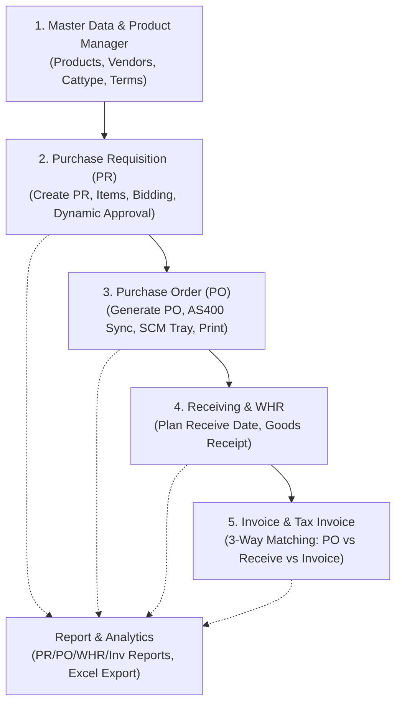
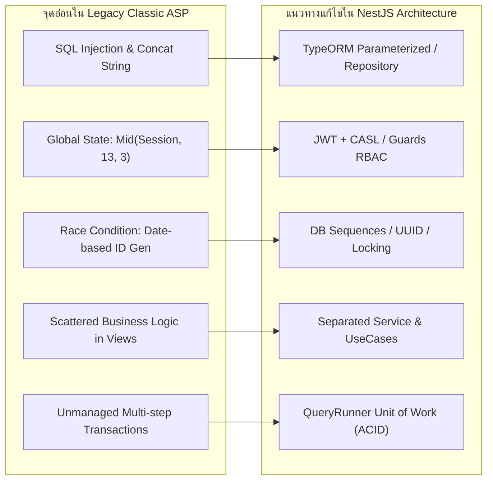
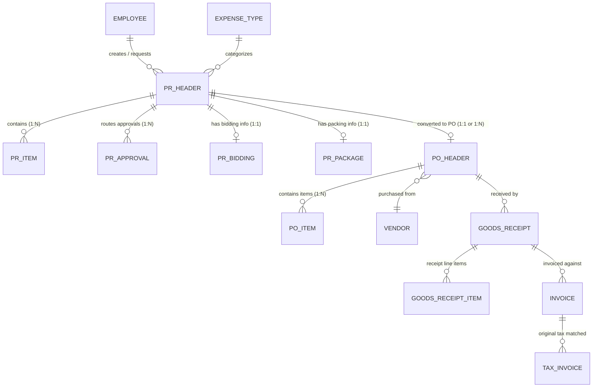
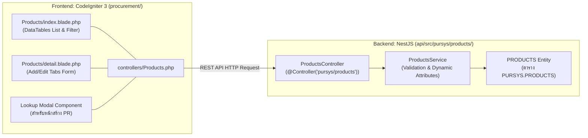
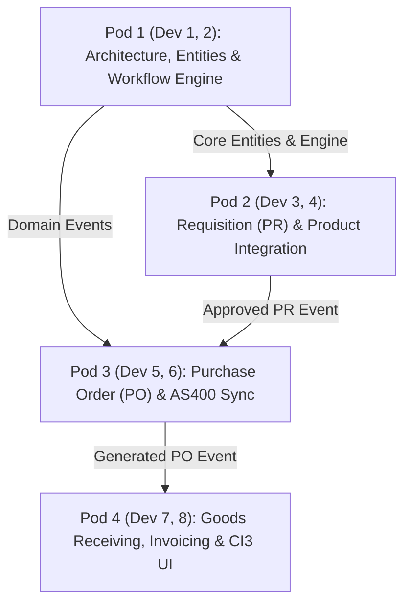

# Action Plan: การ Re-architecture และ Refactor ระบบ Procurement

> **ระบบเป้าหมาย:** สถาปัตยกรรม NestJS Monorepo (TypeScript + TypeORM) ฝั่ง Backend และ CodeIgniter 3 ฝั่ง Frontend  
> **เกณฑ์คุณภาพ:** Clean Architecture, SonarQube Quality Gate, Strict ESLint/Prettier, แยก Layer ชัดเจนรองรับทีมพัฒนา 8 คน  
> **ขอบเขต Source Code เดิม:** `source/procurement` (Classic ASP / VBScript / Oracle / AS400)

---

## สารบัญ
1. [ภาพรวมระบบและวิเคราะห์ฟังก์ชันเดิม (Overview Functions)](#1-ภาพรวมระบบและวิเคราะห์ฟังก์ชันเดิม-overview-functions)
2. [วิเคราะห์ Code Smells & Anti-patterns](#2-วิเคราะห์-code-smells--anti-patterns)
3. [สถาปัตยกรรมและโครงสร้างโปรเจกต์ (Architecture & Directory Structure)](#3-สถาปัตยกรรมและโครงสร้างโปรเจกต์-architecture--directory-structure)
4. [การออกแบบ Entity และ Database Mapping (TypeORM)](#4-การออกแบบ-entity-และ-database-mapping-typeorm)
5. [โมดูลการจัดการสินค้า (Product Master Management)](#5-โมดูลการจัดการสินค้า-product-master-management)
6. [แผนการเขียนโค้ดใหม่ทีละขั้นตอน (Refactoring Steps / WBS สำหรับทีม 8 คน)](#6-แผนการเขียนโค้ดใหม่ทีละขั้นตอน-refactoring-steps--wbs-สำหรับทีม-8-คน)
7. [กลยุทธ์การทดสอบและการควบคุมคุณภาพ (Test Strategy & Quality Gate)](#7-กลยุทธ์การทดสอบและการควบคุมคุณภาพ-test-strategy--quality-gate)

---

## 1. ภาพรวมระบบและวิเคราะห์ฟังก์ชันเดิม (Overview Functions)

ระบบเดิมใน `source/procurement` เป็นเว็บแอปพลิเคชันจัดซื้อจัดจ้างระดับองค์กร พัฒนาด้วย Classic ASP เชื่อมต่อฐานข้อมูล Oracle และระบบ AS400 โดยแบ่งเป็น 5 โดเมนหลัก:



### รายละเอียดฟังก์ชันใน Source เดิม
1. **Purchase Requisition (PR) Workflow (`workflow/`):**
   - การสร้างใบขอซื้อ (`addpr.asp`, `addprcopy.asp`) พร้อมระบบ Urgent PR สำหรับแผนกที่ได้รับสิทธิ์
   - การจัดการรายการสินค้าใน PR (`showpr.asp`, `addpritem.asp`, `editpritem.asp`, `delpritem.asp`)
   - ระบบคำนวณสายการอนุมัติแบบพลวัต (`Createprapp.asp`): ดึงสายอนุมัติตามโครงสร้างฝ่าย/แผนก/หน่วยงาน (`vpappstep`) ร่วมกับประเภทค่าใช้จ่าย (`pexpstep`)
   - การอนุมัติและการมอบอำนาจตัวแทน (`Approve.asp`, `Approve3.asp`, `dupity.asp`)
2. **Purchase Order (PO) Management (`workflow/`):**
   - การแปลง PR ที่อนุมัติแล้วเป็นใบสั่งซื้อ (`Createpo.asp`, `ppo.inc`)
   - การเชื่อมโยงข้อมูลกับระบบ AS400 และ SCM Tray (`connas400.asp`, `sendToSCM`, `removeFromSCM`)
   - การพิมพ์ PO และการยกเลิก PO (`poforprint.asp`, `poprint.asp`, `pocancel.asp`)
3. **Goods Receiving (WHR / Receiving) (`workflow/`):**
   - แผนกำหนดส่งสินค้า (`waitplanrec.asp`, `finishplanrec.asp`, ตาราง `planreceive`)
   - การรับพัสดุเข้าคลังสินค้าและการตรวจรับ (`waitreceive.asp`, `finishrec.asp`, ตาราง `preceive`, `preceiveitem`)
4. **Invoice & Tax Invoice Matching (`workflow/`):**
   - การจัดการสำเนาใบแจ้งหนี้ (`waitinvoice.asp`, `finishInv.asp`, ตาราง `pinvoice`)
   - การจัดการใบกำกับภาษีต้นฉบับ (`waittax.asp`, `finishtax.asp`, ตาราง `ptax`)
   - การตรวจสอบความถูกต้องแบบ 3-Way Matching (PO - Receipt - Invoice)
5. **Master Data Manager (`datamanager/`):**
   - จัดการข้อมูลสินค้า (`Products.asp`, `pproductedt.asp`, `ProductDetail.asp`)
   - จัดการผู้ขาย (`pvender.asp`), ประเภทค่าใช้จ่าย (`pexpenstypeall.asp`), กลุ่มและหมวดหมู่ (`pCattypeall.asp`, `pCatalogall.asp`), สกุลเงิน (`pcurrencyall.asp`), เงื่อนไขการชำระเงิน (`ptermcodeall.asp`)
   - โครงสร้างองค์กรและสายอนุมัติ (`pflowstepall.asp`, `pappflowall.asp`, `pappstepall.asp`)

---

## 2. วิเคราะห์ Code Smells & Anti-patterns



| ลำดับ | จุดอ่อน / Anti-pattern เดิม | รายละเอียดและผลกระทบ (Risk & Impact) | แนวทางแก้ไขใน NestJS / TypeScript |
| :--- | :--- | :--- | :--- |
| **1** | **SQL Injection Vulnerabilities** | ต่อสตริงคำสั่ง SQL โดยตรงจาก `Request()` เช่น `"where sEmpNo = '" & request("sRequester") & "'"` เสี่ยงต่อการถูกเจาะระบบ | ใช้ **TypeORM Repository** และ QueryBuilder พร้อม Parameterized Binding 100% ห้ามใช้ Raw String Concatenation |
| **2** | **Tight Coupling & Business Logic ใน UI** | Logic การคำนวณสิทธิ์, การหา Step ผู้อนุมัติ, และการบันทึกข้อมูล ปะปนอยู่กับโค้ดแสดงผล HTML/Table ในไฟล์ `.asp` เดียวกัน | แยกเลเยอร์ตาม **Clean Architecture**: `Controller` (รับ HTTP/DTO), `Service` (Business Rules), `Repository` (Data Access) |
| **3** | **Session-string Slicing Authorization** | ตรวจสอบสิทธิ์โดยการตัด String Session เช่น `Mid(Session("sAuthor"),13,3) = "AED"` หาก Index คลาดเคลื่อนจะเกิด Privilege Escalation | นำ **RBAC (Role-Based Access Control)** หรือ **CASL Policy Guard** ร่วมกับ JWT Payload มาควบคุมสิทธิ์ในระดับ Method Decorator |
| **4** | **Race Condition ในการสร้างเลขที่เอกสาร (PK)** | ฟังก์ชัน `CreatePRNO` นำปีเดือนวันชั่วโมงนาทีวินาทีมาต่อสตริง หากมี Request ยิงพร้อมกันจะเกิด Duplicate Key ทันที | ใช้ **Database Sequence**, Atomic Auto-increment หรือ Pessimistic Lock (`SELECT FOR UPDATE`) ใน Transaction เดียวกัน |
| **5** | **Lack of Transaction Management (No ACID)** | เมื่อสร้าง PR มีการ Insert ลง `ppr`, วนลูป Insert `pprapp`, `pprbidding`, `pprpackage` แยกคำสั่งกัน หากคำสั่งหลังล้มเหลว ข้อมูลส่วนแรกจะไม่ถูก Rollback | ใช้ **TypeORM `DataSource.transaction()`** หรือ `QueryRunner` เพื่อให้ทุกตาราง Commit พร้อมกัน (Atomic Unit of Work) |
| **6** | **Magic Numbers & Cryptic Status Flags** | ใช้สถานะตัวเลขและสตริงที่ไม่มีเอกสารกำกับ เช่น `cApprov = '0'\|'1'\|'5'`, `cpo = '0'\|'1'\|'2'\|'4'`, Step `35`, `99` | กำหนด **TypeScript Enums** หรือ Value Objects ชัดเจน เช่น `PrStatusEnum`, `ApprovalStatusEnum`, `PoStatusEnum` |
| **7** | **N+1 Query Explosion** | วนลูปอ่าน Recordset แล้วยิง Query ซ้อนในแต่ละรอบ (เช่น วนลูปพนักงานแล้วไปคิวรีสิทธิ์ `vpappstep` รายคน) | ใช้ Relation Eager/Lazy Loading หรือ `LEFT JOIN` / `IN (...)` ใน TypeORM เพื่อดึงข้อมูลในครั้งเดียว |
| **8** | **Plaintext Credentials & Unbuffered AS400 Sync** | ไฟล์ `connas400.asp` มีการ Hardcode Username/Password และเปิด Connection ข้าม Server แบบ Synchronous ระหว่าง Request | ใช้ **Environment Variables (`.env`)** เก็บ Credential และใช้ **BullMQ (Message Queue)** ทำ Background Job ในการ Sync กับ AS400 |

---

## 3. สถาปัตยกรรมและโครงสร้างโปรเจกต์ (Architecture & Directory Structure)

โครงสร้างโปรเจกต์ถูกออกแบบเป็น **Monorepo** เพื่อให้ทีมพัฒนา 8 คนแบ่งงานกันทำในโมดูลอิสระ (Feature Modules) ลดการเกิด Git Merge Conflicts โดยมีโฟลเดอร์ทดสอบ `tests/` แยกไว้ที่ Root ตามข้อกำหนด:

```text
rea-procurement/
├── apps/
│   └── api/                           # NestJS Backend Application
│       ├── src/
│       │   ├── common/                # Shared Kernel (Guards, Interceptors, Filters, Utils)
│       │   │   ├── decorators/        # Roles, CurrentUser, Permissions
│       │   │   ├── filters/           # Global Exception Filters (SonarQube compliance)
│       │   │   ├── guards/            # JwtAuthGuard, RolesGuard
│       │   │   ├── interceptors/      # TransformInterceptor, LoggingInterceptor
│       │   │   └── utils/             # Date converters, Doc Number Generators
│       │   ├── config/                # Environment & Database Configurations
│       │   ├── database/              # DataSources, Migrations, Seeders
│       │   └── modules/               # Domain-Driven Feature Modules
│       │       ├── auth/              # Authentication & Session Handlers
│       │       ├── master-data/       # Categories, Units, Currencies, Terms
│       │       ├── organization/      # Divisions, Departments, Sections, Positions, Employees
│       │       ├── workflow-engine/   # Approval Flow Routing, Step Resolvers, Delegation
│       │       ├── requisition/       # PR Header, PR Items, PR Bidding, Packaging
│       │       ├── purchase-order/    # PO Header, PO Items, PO Print, PO Cancel
│       │       ├── receiving/         # Plan Receive, WHR Goods Receipt, Inspection
│       │       ├── invoice-tax/       # Invoice Matching, Tax Invoice, 3-Way Match
│       │       ├── external-sync/     # AS400 / SCM Queue Consumer & Integration
│       │       └── reports/           # Financial & Operational Analytics / Exports
│       ├── nest-cli.json
│       ├── tsconfig.json
│       └── package.json
├── frontend/                          # CodeIgniter 3 Frontend Client (procurement/)
│   ├── application/
│   │   ├── config/                    # CI3 Settings (api_endpoint.php, routes.php)
│   │   ├── controllers/               # Route Controllers (Products, PurchaseReq, Vendors, PO, etc.)
│   │   ├── libraries/
│   │   │   └── Api_client.php         # Centralized HTTP Client (Guzzle/cURL calling NestJS API)
│   │   └── views/                     # Modern Blade/HTML5 Views
│   │       ├── Products/              # Product Master Views (index.blade.php, detail.blade.php)
│   │       ├── pr/                    # Purchase Requisition Views
│   │       ├── po/                    # Purchase Order Views
│   │       ├── receiving/             # Warehouse Receiving Views
│   │       └── layouts/               # Template, Navigation, Modals
│   └── system/
├── tests/                             # Root-Level Test Suites (SonarQube Target)
│   ├── unit/                          # Unit Tests for Services & Business Logic
│   │   ├── workflow/
│   │   ├── requisition/
│   │   └── purchase-order/
│   ├── e2e/                           # End-to-End API Scenario Tests (Supertest)
│   │   ├── pr-approval-lifecycle.e2e-spec.ts
│   │   ├── po-creation-sync.e2e-spec.ts
│   │   └── three-way-matching.e2e-spec.ts
│   ├── fixtures/                      # Mock Data, DTO Payloads, Test DB Seeders
│   └── jest.config.root.ts
├── .eslintrc.js                       # Strict Linting Rules
├── .prettierrc                        # Standard Code Formatting Rules
├── sonar-project.properties           # SonarQube Scanner Configuration
└── docker-compose.yml                 # Local Dev Environment
```

---

## 4. การออกแบบ Entity และ Database Mapping (TypeORM)



### รายละเอียดโครงสร้าง Entity หลัก:

#### 4.1 `PrHeader` (ตารางเดิม: `PPR`)
```typescript
import {
  Entity,
  PrimaryColumn,
  Column,
  CreateDateColumn,
  OneToMany,
  Index,
} from 'typeorm';
import { PrItem } from './pr-item.entity';
import { PrApproval } from './pr-approval.entity';
import { PrStatusEnum, PrUrgentTypeEnum } from '../enums/pr.enum';

@Entity({ name: 'PPR' })
export class PrHeader {
  @PrimaryColumn({ name: 'SPRNO', type: 'varchar', length: 20 })
  prNo: string;

  @Column({ name: 'SEXPTYPE', type: 'varchar', length: 10 })
  expenseType: string;

  @CreateDateColumn({ name: 'DPRDATE', type: 'date' })
  prDate: Date;

  @Column({ name: 'SDELIVERY', type: 'varchar', length: 100, nullable: true })
  deliveryPlace: string;

  @Column({ name: 'DDELIVERY', type: 'date', nullable: true })
  deliveryDate: Date;

  @Column({ name: 'SREQUESTER', type: 'varchar', length: 20 })
  @Index()
  requesterEmpNo: string;

  @Column({ name: 'SKEY', type: 'varchar', length: 20 })
  keyInEmpNo: string;

  @Column({
    name: 'CAPPROVE',
    type: 'varchar',
    length: 2,
    default: PrStatusEnum.PENDING,
  })
  status: PrStatusEnum;

  @Column({ name: 'CPO', type: 'varchar', length: 2, default: '0' })
  poStatus: string;

  @Column({
    name: 'CPRTYPE',
    type: 'varchar',
    length: 1,
    default: PrUrgentTypeEnum.NORMAL,
  })
  prType: PrUrgentTypeEnum;

  @Column({ name: 'NSTEP', type: 'int', default: 1 })
  currentStep: number;

  @Column({ name: 'FYEAR', type: 'varchar', length: 4, nullable: true })
  fiscalYear: string;

  @OneToMany(() => PrItem, (item) => item.prHeader, { cascade: true })
  items: PrItem[];

  @OneToMany(() => PrApproval, (app) => app.prHeader, { cascade: true })
  approvalSteps: PrApproval[];
}
```

#### 4.2 `PrApproval` (ตารางเดิม: `PPRAPP`)
```typescript
import {
  Entity,
  PrimaryColumn,
  Column,
  ManyToOne,
  JoinColumn,
  Index,
} from 'typeorm';
import { PrHeader } from './pr-header.entity';

@Entity({ name: 'PPRAPP' })
export class PrApproval {
  @PrimaryColumn({ name: 'SPRNO', type: 'varchar', length: 20 })
  prNo: string;

  @PrimaryColumn({ name: 'NSTEP', type: 'int' })
  stepNo: number;

  @Column({ name: 'SSTEP', type: 'varchar', length: 5 })
  stepCode: string;

  @Column({ name: 'SEMPNO', type: 'varchar', length: 20 })
  @Index()
  approverEmpNo: string;

  @Column({ name: 'SEMPNOAPP', type: 'varchar', length: 20, nullable: true })
  representativeEmpNo: string;

  @Column({ name: 'CAPPROV', type: 'varchar', length: 1, default: '0' })
  isApproved: string; // '0'=Waiting, '1'=Approved, '2'=Rejected, '5'=Auto-approved

  @Column({ name: 'DAPPDATE', type: 'date', nullable: true })
  approvedDate: Date;

  @Column({ name: 'TAPPTIME', type: 'varchar', length: 10, nullable: true })
  approvedTime: string;

  @Column({ name: 'SCOMMENT', type: 'varchar', length: 500, nullable: true })
  comment: string;

  @ManyToOne(() => PrHeader, (pr) => pr.approvalSteps, { onDelete: 'CASCADE' })
  @JoinColumn({ name: 'SPRNO' })
  prHeader: PrHeader;
}
```

#### 4.3 `PoHeader` (ตารางเดิม: `PPO`)
```typescript
@Entity({ name: 'PPO' })
export class PoHeader {
  @PrimaryColumn({ name: 'SPONO', type: 'varchar', length: 20 })
  poNo: string;

  @Column({ name: 'SREFNO', type: 'varchar', length: 20 })
  @Index()
  refPrNo: string;

  @Column({ name: 'SVENDCODE', type: 'varchar', length: 20 })
  vendorCode: string;

  @Column({ name: 'DPODATE', type: 'date' })
  poDate: Date;

  @Column({ name: 'CSTATUS', type: 'varchar', length: 2, default: '1' })
  status: string; // '1'=Draft, '2'=Approved, '3'=Printed, '9'=Cancelled

  @Column({ name: 'SCM_STATUS', type: 'varchar', length: 1, default: 'N' })
  scmSentStatus: string;
}
```

---

## 5. โมดูลการจัดการสินค้า (Product Master Management)

Product Master ถือเป็นแกนหลักของข้อมูลสินค้า/พัสดุที่ถูกอ้างอิงตลอดทั้งวงจร (PR Items, PO Items, WHR Inventory):



### การจับคู่ (Mapping) ระหว่างระบบเดิมและระบบใหม่:
1. **Classic ASP เดิม (`source/procurement/datamanager/`):**
   - `Products.asp` -> ตารางรายการพัสดุและตัวกรอง
   - `pproductedt.asp` -> ฟอร์มเพิ่ม/แก้ไขข้อมูลพัสดุ, Spec, Drawing Number, รูปภาพ
   - `ProductDetail.asp` / `vpproduct.asp` -> หน้ารายละเอียดพัสดุ
   - `workflow/showproduct.asp` -> หน้าต่าง Modal Popup ให้เลือกพัสดุตอนสร้าง PR
2. **Backend API (`api/src/pursys/products/`):**
   - Controller: `products.controller.ts` (Endpoint: `/pursys/products`)
   - Service: `products.service.ts` (รองรับ Dynamic Attributes ตามหมวดหมู่ผ่าน `OptionRegistryService`)
   - Entity: `PRODUCTS.entity.ts` (ตาราง `PURSYS.PRODUCTS` พร้อมความสัมพันธ์กับ Categories และ Units)
3. **Frontend CI3 (`procurement/application/`):**
   - Controller: `controllers/Products.php`
   - Views: `views/Products/index.blade.php` (DataTables) และ `views/Products/detail.blade.php` (Tab Form)

---

## 6. แผนการเขียนโค้ดใหม่ทีละขั้นตอน (Refactoring Steps / WBS สำหรับทีม 8 คน)



| สัปดาห์ (Sprint) | Pod 1: Core & Approval Engine (Dev 1, 2) | Pod 2: PR & Items (Dev 3, 4) | Pod 3: PO & AS400 Sync (Dev 5, 6) | Pod 4: Receiving, Invoice & CI3 (Dev 7, 8) |
| :---: | :--- | :--- | :--- | :--- |
| **Sprint 1**<br>*(Base Setup)* | 1.1 เซ็ตอัป NestJS Monorepo, TypeORM Datasource, ESLint, Prettier, SonarQube<br>1.2 สร้าง Base Entities, JWT Auth Guard และ Exception Filter | 2.1 สร้าง DTOs และ Entity สำหรับ `PPR`, `PPRITEM`, `PPRBIDDING`<br>2.2 ทำ Repository & Seed Data สำหรับทดสอบ | 3.1 สร้าง Entity สำหรับ `PPO`, `PPOITEM`<br>3.2 ออกแบบ Repository และ Interface สำหรับ AS400 / SCM Service | 4.1 ติดตั้งและวางโครงสร้าง CI3 App Client & `Api_client.php`<br>4.2 ปรับปรุง `Products/index.blade.php` และ `detail.blade.php` |
| **Sprint 2**<br>*(Domain Logic)* | 1.3 พัฒนา Dynamic Approval Resolver (คำนวณ Step จากสายบังคับบัญชา `vpappstep` + `pexpstep`)<br>1.4 สร้างระบบ Delegate / Representative Approver | 2.3 พัฒนา PR Creation UseCase พร้อม Transaction Atomic (Header + Items + Bidding)<br>2.4 สร้าง Product Lookup Component สำหรับเลือกสินค้าตอนสร้าง PR | 3.3 พัฒนา PO Generator จาก Approved PR<br>3.4 สร้าง BullMQ Producer สำหรับงาน Sync PO ไปยัง AS400/SCM | 4.3 สร้าง Entity และ CRUD สำหรับ `PLANRECEIVE` และ `PRECEIVE` (WHR)<br>4.4 พัฒนาหน้าจอ CI3: หน้าบันทึก PR และหน้าติดตามสถานะ |
| **Sprint 3**<br>*(Lifecycle & Match)* | 1.5 พัฒนา Approval Workflow Execution (Approve, Reject, Comment, Step Increment)<br>1.6 สร้าง Event Emitter แจ้งเตือนทาง Email | 2.5 พัฒนา PR Search/Filter (By Requester, Date, Expense Type)<br>2.6 ทำ Unit Tests ครอบคลุม PR Domain | 3.5 ทำ PO Printing PDF Service และ PO Cancellation Logic<br>3.6 Unit Test สำหรับ AS400 Consumer & Fallback Retry | 4.5 พัฒนา 3-Way Matching Service (`PO` ↔ `Receive` ↔ `Invoice` ↔ `Tax`)<br>4.6 พัฒนาหน้าจอ CI3: หน้า PO Management & WHR Check-in |
| **Sprint 4**<br>*(Integration & Quality)* | 1.7 รัน SonarQube ตรวจสอบ Code Smells และ Refactor จุดที่หลุด Quality Gate | 2.7 ร่วมทำ E2E Test Flow: PR Create -> Multi-step Approval | 3.7 ร่วมทำ E2E Test Flow: PR Approved -> PO Auto-gen | 4.7 พัฒนาหน้าจอ Report และ Export Excel ใน CI3<br>4.8 ตรวจสอบ E2E Coverage ให้ผ่านเกณฑ์ >= 80% |

---

## 7. กลยุทธ์การทดสอบและการควบคุมคุณภาพ (Test Strategy & Quality Gate)

### 7.1 SonarQube Quality Gate Thresholds
- **Code Coverage**: >= 80% (ครอบคลุม Service และ Business Logic ทั้งหมด)
- **Security Hotspots & Vulnerabilities**: 0 (ห้ามมี Blocker/Critical)
- **Code Smells**: Maintainability Rating 'A'
- **Duplicated Lines Density**: <= 3.0%
- **Cognitive Complexity**: <= 15 ต่อ 1 ฟังก์ชัน

### 7.2 Unit Test Matrix (Jest)
1. **Dynamic Step Calculation Test**:
   - ตรวจสอบ Requester สังกัด Section/Department ต่างๆ ต้องได้รับ Approval Path ที่ถูกต้อง
   - ตรวจสอบประเภทค่าใช้จ่ายพิเศษ (เช่น IT `54` หรือ Safety `B0`) ต้องเพิ่ม Step ตาม `pexpstep`
   - ตรวจสอบเงื่อนไข Urgent PR (`cprtype = '1'`) ต้องมี Step ที่ถูกต้องตามนโยบาย
2. **Representative Approver Test**:
   - ทดสอบการอนุมัติแทน (Delegate): เมื่อตัวแทนอนุมัติ ต้องบันทึก `sEmpnoapp` และขยับ Step ได้ถูกต้อง
3. **Atomic Rollback Verification**:
   - Mock ข้อผิดพลาดระหว่าง Insert Item -> ตรวจสอบว่า PR Header จะต้องถูก Rollback ห้ามหลงเหลือในฐานข้อมูล
4. **Three-Way Matching Calculation**:
   - ตรวจสอบยอดเงินและจำนวนระหว่าง PO, Goods Receipt, และ Invoice หากไม่ตรงกันต้อง Throw `ConflictException`

### 7.3 E2E Test Scenarios (Supertest)
```typescript
describe('Procurement Workflow E2E Test', () => {
  it('Scenario 1: Full PR to PO Lifecycle', async () => {
    // 1. Staff creates PR with items
    const prRes = await request(app.getHttpServer())
      .post('/api/requisitions')
      .set('Authorization', `Bearer ${staffToken}`)
      .send(mockCreatePrDto)
      .expect(201);
    const prNo = prRes.body.prNo;

    // 2. Step 1 Manager approves
    await request(app.getHttpServer())
      .patch(`/api/workflow/${prNo}/approve`)
      .set('Authorization', `Bearer ${mgrToken}`)
      .send({ comment: 'Approved by Mgr' })
      .expect(200);

    // 3. Final Step Director approves -> Status becomes APPROVED
    await request(app.getHttpServer())
      .patch(`/api/workflow/${prNo}/approve`)
      .set('Authorization', `Bearer ${directorToken}`)
      .send({ comment: 'Final approval' })
      .expect(200);

    // 4. Purchaser generates PO from approved PR
    const poRes = await request(app.getHttpServer())
      .post('/api/purchase-orders/from-pr')
      .set('Authorization', `Bearer ${purchaserToken}`)
      .send({ prNo, vendorCode: 'VND001' })
      .expect(201);

    expect(poRes.body.poNo).toBeDefined();

    // 5. Warehouse receives Goods against PO
    await request(app.getHttpServer())
      .post('/api/receiving')
      .set('Authorization', `Bearer ${warehouseToken}`)
      .send({ poNo: poRes.body.poNo, items: [{ itemNo: 1, qty: 10 }] })
      .expect(201);
  });
});
```
